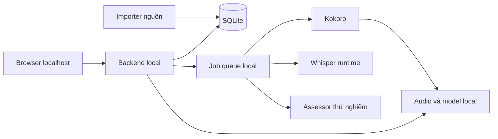

# American English Coach — luyện tiếng Anh Mỹ local trong 90 ngày

Phiên bản 3 · 2026-10-11 · Đã có bản local chạy được; xem README.md và docs/VERIFICATION.md.

Tài liệu liên quan: [so sánh repo và công nghệ giọng nói](docs/REPOSITORY-RESEARCH.md). Các số lượng nội dung, ngưỡng và cấu hình dưới đây là **đề xuất**, chưa phải kết quả đã đạt.

## Phạm vi bản đã triển khai

Trọng tâm theo yêu cầu mới: **44 mục IPA + toàn bộ 466.550 mục của words.txt**. Bảng 44 truyền thống có một số âm/ký hiệu Anh–Anh, nên mỗi mục có đối chiếu Mỹ rõ ràng, không quảng cáo Mỹ có đúng 44 âm vị độc lập.

- Bảng âm, hướng dẫn khẩu hình tiếng Việt, từ mẫu, nghe TTS Mỹ local, thu âm/nghe lại và tự đánh giá từng âm.
- Kho SQLite tra theo tiền tố, lọc âm, phân trang; 72.072 mục ghép được phát âm. Từ thông dụng được ưu tiên trong từng âm.
- **115.655 mục có nghĩa Việt**, gồm đối chiếu biến thể; nguồn thichhoc là dịch máy chưa kiểm duyệt và được ghi nhãn. Không khẳng định toàn bộ 466.550 mục đều có nghĩa hay IPA.
- IPA dùng Noto Sans local, chữ lớn, phiên âm viết liền từ ipa-dict, tô âm đang luyện, tùy chọn phóng lớn. Biến thể phát âm hiển thị riêng; chưa liên kết từng biến thể với từ loại.
- Gói phụ: 120 mục từ/nghĩa và 60 câu, luyện nghe–chép, thẻ ôn, theo dõi và sao lưu local. Nội dung luân phiên trong lịch 90 ngày.
- Runtime thực tế: Python 3.9+ standard library, SQLite, HTML/CSS/JS, macOS `say`. Không API trả phí hay model cloud.
- Chưa có chấm phát âm AI, STT, 90 bộ bài độc lập, FSRS hoặc kiểm tra CEFR. Các tính năng nâng cao ở phần kế hoạch bên dưới là hướng phát triển, không phải chức năng hiện hữu.

## 1. Ràng buộc đã chốt

Người dùng muốn phát âm Mỹ, đọc/hiểu từ mới, nghe và viết lại được trong lộ trình 3 tháng. Dự án phải chạy trên máy cá nhân, chi phí gần bằng 0.

- Không API trả phí, API key, tài khoản cloud, subscription hoặc thuê server.
- Từ điển, audio, model, bản ghi và tiến độ nằm trên máy; không gửi giọng nói ra ngoài.
- Mạng chỉ cần cho cài đặt/tải dependency, model và dữ liệu; nội dung đã cài học được offline.
- Đề xuất giao diện web localhost, một người dùng; không đăng nhập/đồng bộ trong bản đầu.
- Không bắt buộc Docker, Redis hay GPU. Không kế thừa yêu cầu của dự án khác.
- Không dùng browser speech recognition làm nền tảng vì cần kiểm soát việc xử lý local.

Máy hiện tại báo kiến trúc arm64; chưa xác định được RAM trong sandbox, chưa benchmark. Ưu tiên khảo sát runtime Apple Silicon, có chế độ CPU nhẹ. Trình độ/thời lượng chưa có: tạm thiết kế 60 phút/ngày, chỉnh được 30/60/90 phút. Web là đề xuất giảm công cài đặt, chưa phải quyết định mobile native.

## 2. Kết quả học và cách đo

| Năng lực | Hành vi cần luyện | Kiểm tra |
|---|---|---|
| Phát âm Mỹ | Âm rõ, âm cuối, trọng âm, nhịp/nối âm, ngữ điệu | Thu âm từ/câu mới, nghe A/B, rubric và phản hồi âm đã kiểm chứng |
| Đọc từ mới | Nhận quan hệ chữ–âm, dùng IPA, nhận biết ngoại lệ | Đọc trước khi nghe mẫu; đo riêng lượt có/không IPA |
| Hiểu từ/câu | Nhớ nghĩa theo ngữ cảnh, chọn đúng nghĩa và dùng từ | Câu hỏi nghĩa, diễn giải, câu tự viết |
| Nghe–viết | Nhận ra âm/cụm, viết lại và hiểu nội dung | Chép audio mới; chấm nghe, chính tả và hiểu nghĩa riêng |

Giọng mẫu hướng đến các cách đọc Mỹ tương thích, không coi mọi biến thể khác mẫu là lỗi. Từ đa cách đọc, tên riêng và từ đồng âm cần tra cứu/ngữ cảnh; không hứa đọc/hiểu mọi từ chỉ từ chữ hoặc âm.

90 ngày × 60 phút = 90 giờ tự học; 90 phút/ngày = 135 giờ. [Cambridge English](https://support.cambridgeenglish.org/hc/en-gb/articles/202838506-Guided-learning-hours) nêu khoảng 200 giờ học có hướng dẫn để chuyển một mức CEFR, thay đổi theo người học. Không quy đổi thời gian app thành chứng nhận CEFR hoặc giọng bản xứ. Đánh giá cuối dựa trên tiến bộ so đầu vào và bài chưa luyện.

## 3. Ngày đầu và buổi học hàng ngày

### Kiểm tra đầu vào 20–30 phút, có thể chia hai lượt

1. Chọn thời lượng, chủ đề và tự đánh giá; không suy trình độ chỉ từ lựa chọn này.
2. Kiểm tra mic, lưu một bản ghi đường cơ sở; mic nhiễu/im lặng không bị chấm thấp.
3. Đề xuất 12 câu phân biệt âm, 10 câu nghe chép tăng độ khó, 10 câu hỏi nghĩa.
4. Thu âm 10 từ và 5 câu; đọc một số từ trước khi nghe mẫu.
5. Lưu kết quả từng kỹ năng và trợ giúp đã dùng; không gắn CEFR chắc chắn từ bài nội bộ chưa chuẩn hóa.
6. Tạo tuần đầu, chọn tối đa hai nhóm yếu làm trọng tâm. Bài quá khó thì chuyển mức đơn giản hơn.

### Một buổi 60 phút

| Phần | Phút đề xuất | Người học thực hiện |
|---|---:|---|
| Ôn đến hạn | 10 | Nhớ nghĩa, nghe–viết hoặc đọc theo kỹ năng yếu |
| Âm/trọng âm | 15 | Hướng dẫn Việt, phân biệt âm, thu âm và nghe A/B |
| Nghe chép | 15 | Nghe khi chưa thấy chữ, viết, xem lỗi, nghe lại phần khó |
| Từ trong ngữ cảnh | 10 | 5–10 mục vừa sức, chọn nghĩa và viết câu |
| Shadowing/nói | 10 | Bắt chước nhịp rồi nói lại khi ẩn transcript |

30 phút giảm bài mới, giữ ôn và trọng tâm. 90 phút thêm speaker và nói tự do. Không tăng tải để bù mọi ngày bỏ học. Có thể nghỉ/chia buổi; lượng bài mới giảm khi tồn nhiều bài ôn.

## 4. Chức năng và tiêu chí nghiệm thu

### Trang hôm nay

Hiển thị nhiệm vụ, lý do chọn bài và thời lượng. Tiếp tục bài dở sau restart, không ghi trùng attempt. Cuối buổi chỉ ra tối đa hai lỗi ưu tiên và lịch ôn. Đổi thời lượng không làm mất tiến độ.

### Phòng luyện âm Mỹ

Mỗi âm có IPA, hướng dẫn vị trí lưỡi/môi tiếng Việt, audio, cặp dễ nhầm và ví dụ trong từ/câu. Hình khẩu hình cần được kiểm tra trước xuất bản. Bài nghe trả lời trước khi thấy đáp án; bài nói có thu âm và phát bản mẫu/bản thân xen kẽ.

Có giọng mặc định và giọng thứ hai đã duyệt. Tách nói đủ từ, phát âm, nhịp và tự đánh giá; chưa có assessor tin cậy thì không hiển thị điểm accent. Nghiệm thu: bài hoàn chỉnh chạy offline, mic bị từ chối có hướng xử lý, audio lỗi không bị tính là trả lời sai.

### Nghe chép chính tả

Ba mức: từ trong ngữ cảnh, câu, đoạn ngắn. Không dùng homophone đơn lẻ để ép một cách viết. Ghi lần nghe đầu/lần nghe lại và trợ giúp; bài kiểm tra khóa đáp án trước khi lộ transcript.

Chấm thiếu/thừa/thay từ, gợi ý lỗi chính tả; không tự xem typo gần đúng là đã nghe hiểu. Chính sách chuẩn hóa chữ hoa/dấu câu/apostrophe và đáp án số/contractions phải có phiên bản. Không làm mất khác biệt can/can't. Cho người học đánh dấu “nghe được nhưng viết sai”; lỗi âm suy từ đáp án chỉ là giả thuyết. Thêm câu hỏi hiểu nghĩa sau khi chép.

Nghiệm thu: contraction, số, homophone có ngữ cảnh và dấu câu được xử lý đúng policy; báo cáo lần đầu và sau trợ giúp riêng.

### Tra từ và đọc từ mới

Tra offline theo từ/từ loại/nghĩa; có nghĩa Anh/Việt, IPA Mỹ, trọng âm, ví dụ, audio và nguồn khi có. record danh/động từ, read hiện tại/quá khứ có cách đọc riêng. Thiếu nghĩa không tự bịa; G2P phải ghi “cách đọc dự đoán”. Cho nhập ghi chú cá nhân.

Bài đọc mới: thử đọc → thu âm → xem IPA/nghe mẫu → sửa → dùng trong câu. Có IPA nhập môn, không dùng chữ Việt làm cách đọc chuẩn. Nghiệm thu: từ thiếu dữ liệu có nhãn, từ đa cách đọc không chấm bằng mẫu duy nhất.

### Sổ lỗi và ôn tập

Lưu lỗi theo item/kỹ năng/thời điểm/trợ giúp. Biết nghĩa nhưng chưa nghe ra là hai trạng thái riêng. Đề xuất FSRS qua adapter cho thẻ nhớ; bài âm/câu có lịch mastery riêng. [ts-fsrs](https://github.com/open-spaced-repetition/ts-fsrs) là ứng viên nếu chọn runtime TypeScript, không bắt buộc thêm Node chỉ để ôn thẻ.

Giới hạn đề xuất 20 mục ôn/buổi; giảm bài mới khi quá tải. Nghiệm thu: lịch đúng sau restart/đổi ngày, submit lại không tạo review trùng, export/restore được.

### Báo cáo tuần

Dùng bài mới có độ khó tương đương; tách audio human/TTS, speaker quen/mới, nghe đầu/nghe lại. Báo độ chính xác chép, hiểu nghĩa, nhớ sau ôn và rubric bản ghi; không gộp thành “% thành thạo”. Bài giữ lại không được xuất hiện trong luyện hoặc biến thể gần trùng. Đổi model chấm phải ghi phiên bản, không so điểm như cùng thang đo.

## 5. Giáo trình 12 tuần và 6 ngày đánh giá

Đây là thứ tự dự kiến, điều chỉnh theo đầu vào. Các âm là ví dụ ưu tiên, không chẩn đoán mặc định mọi người Việt.

| Tuần | Trọng tâm | Áp dụng/kiểm tra |
|---|---|---|
| 1 | Đầu vào, IPA nhập môn, âm cuối, /iː/–/ɪ/ | Từ/câu ngắn, bản ghi đường cơ sở |
| 2 | /ɛ/–/æ/, /ʊ/–/uː/, schwa | Minimal pairs, chép câu mới |
| 3 | /θ/–/ð/, /s/–/ʃ/, /tʃ/–/dʒ/, hữu thanh | Phân biệt âm và đọc trong câu |
| 4 | /ɹ/, cụm phụ âm, -s/-ed | Đọc biến đổi từ; kiểm tra tháng đầu |
| 5 | Trọng âm từ, họ từ, chữ–âm/ngoại lệ | Đọc từ chưa luyện, trước/sau IPA |
| 6 | Trọng âm câu, weak forms | Chép cụm, shadowing, hiểu trọng tâm |
| 7 | Nối âm, flap /t/, rhythm Mỹ | Câu tự nhiên, ghi riêng số lần nghe |
| 8 | Ngữ điệu và nhiều speaker | Audio người thật được chọn; đánh giá giữa kỳ |
| 9 | Giới thiệu, mua sắm, đường đi | Chép hội thoại và đóng vai có prompt |
| 10 | Công việc/học tập theo nhu cầu | Nghe ghi chú và giải thích ý |
| 11 | Đoạn 30–60 giây, diễn đạt lại | Hiểu ý chính, nói 1–2 phút với rubric |
| 12 | Lỗi cá nhân và nội dung mới | Từ/câu/speaker giữ lại, luyện điểm yếu |
| Ngày 85–90 | Đánh giá cuối và kế hoạch tiếp tục | Bài tương đương đầu vào, thu âm mới |

Người mới có thể cần kéo dài tuần 1–4; mốc ngày không ép vượt bài. Nói tự do MVP dùng prompt/rubric, không cần chatbot cloud hay LLM local nặng.

## 6. Nội dung cần sản xuất

Tách kho tra cứu lớn khỏi bài học được duyệt; không biến hàng trăm nghìn từ thành nghĩa vụ học.

| Gói | Quy mô đề xuất | Điều kiện |
|---|---|---|
| Pilot một tuần | 100 từ/nghĩa, 60 câu, 10 bài âm/nhịp | Nghĩa Việt, IPA, audio, đáp án được duyệt |
| Bản học đầu | 300 mục từ/nghĩa, 150 câu, 20 bài âm/nhịp | Nhiều độ khó, bài giữ lại, tối thiểu 2 voice duyệt |
| Gói 90 ngày | Khoảng 800–1.200 mục từ/cụm/nghĩa, 400–600 câu, 30–50 đoạn | Mục tiêu sản xuất; lượng học thực tế tùy đầu vào/tải ôn |

“Mục” là nghĩa/cụm sử dụng, không đồng nghĩa lemma độc lập. Các gói chưa được tạo. Cần đo công biên tập qua pilot trước khi hẹn ngày hoàn thành. Mỗi bài có mục tiêu, điều kiện trước, kỹ năng, độ khó nội bộ, item, đáp án/policy, audio và giải thích lỗi. Không suy CEFR từ tần suất.

## 7. Nguồn dữ liệu và voice đề xuất

| Thành phần | Nguồn local | Vai trò/giới hạn |
|---|---|---|
| Phát âm Mỹ | [CMUdict](https://github.com/cmusphinx/cmudict) | Âm vị, stress, biến thể; thiếu nghĩa/audio |
| Ưu tiên học | [wordfreq](https://github.com/rspeer/wordfreq) | Tần suất; giữ attribution/giấy phép dữ liệu |
| Nghĩa Anh | [Open English Wordnet](https://github.com/globalwordnet/english-wordnet) | Nghĩa có cấu trúc, thêm lớp Việt được biên tập |
| Kho mở rộng | [Kaikki](https://kaikki.org/dictionary/English/), [Wiktextract](https://github.com/tatuylonen/wiktextract) | Lọc nguồn/giọng/giấy phép; chưa nhập toàn dump |
| Danh sách phụ | [dwyl/english-words](https://github.com/dwyl/english-words) | Tra cứu tùy chọn, không giáo trình/định nghĩa |
| TTS Mỹ | [Kokoro](https://github.com/hexgrad/kokoro) | Ứng viên tạo local, cần nghe/đo trước chốt |
| Audio người thật | [LibriSpeech](https://www.openslr.org/12), [Tatoeba](https://tatoeba.org/en/terms_of_use) | Chọn clip, kiểm tra accent/transcript/quyền dùng |
| ASR | [whisper.cpp](https://github.com/ggml-org/whisper.cpp), CPU [faster-whisper](https://github.com/SYSTRAN/faster-whisper) | Chọn một runtime sau benchmark |
| Assessment thử nghiệm | [OpenPronounce](https://github.com/Halleck45/OpenPronounce), R&D [GOPT](https://github.com/YuanGongND/gopt) | Chưa đủ căn cứ sửa âm tự động cho người Việt |

Loại cloud assessment khỏi triển khai. Free tier không là lời giải chi phí 0 lâu dài. Browser TTS chỉ tiện ích tùy chọn, không giọng mẫu bắt buộc vì giọng/offline khác nhau theo OS. Xem [nghiên cứu](docs/REPOSITORY-RESEARCH.md) cho phương án thay thế/giấy phép; chưa cài hay chạy các model.

## 8. Phản hồi phát âm local

Ba mức hiển thị tách biệt:

1. MVP: phân biệt âm, hướng dẫn Việt, thu âm, nghe A/B, rubric tự kiểm. Dùng được khi ASR tắt.
2. ASR tùy chọn: transcript và gợi ý thiếu từ; kết quả máy nghe, không kết luận sai âm. Mic lỗi/im lặng không sinh điểm.
3. Assessment thử nghiệm: chỉ bật nhóm lỗi qua kiểm chứng. Lỗi chưa chắc được ghi “cần nghe/kiểm tra lại”, không khẳng định phoneme sai chỉ vì transcript khác.

Rubric tự kiểm đề xuất 0–2 cho âm đích, âm cuối, trọng âm, nhịp và dễ hiểu; ghi rõ tự đánh giá. Bản ghi đầu/cuối giúp nghe thay đổi, không thay thế nhận xét chuyên môn.

[OpenPronounce](https://github.com/Halleck45/OpenPronounce) công bố false alarms đáng kể; [SpeechOcean762](https://www.openslr.org/101) dùng người có tiếng mẹ đẻ Mandarin. Vì vậy model tải về chưa được coi là assessor đáng tin cho người Việt. Pilot dùng bản ghi tự nguyện; nếu thiếu người chấm chuyên môn thì mức 3 giữ thử nghiệm, không yêu cầu thuê dịch vụ trả phí.

## 9. Kiến trúc một máy

Đề xuất app modular, web static và backend local cùng launcher; chưa microservices.

- Backend Python đề xuất để tích hợp model; framework/frontend chốt khi triển khai, build UI static phục vụ cùng app.
- SQLite lưu nội dung, attempt và job; chưa cần Redis/PostgreSQL.
- File audio/model trong data directory; bản ghi người học không nằm trong source repo.
- Tối đa một inference nặng đồng thời; nạp model khi cần, không nạp tất cả. TTS tạo trước/cache, học chỉ phát lại.
- Bind 127.0.0.1 mặc định. Điện thoại/LAN là bước riêng cần xử lý quyền truy cập/mic HTTPS.
- Export SQLite snapshot + metadata + audio tùy chọn; restore thử trên bản sao. Xóa bản ghi vẫn giữ kết quả nếu người học muốn.
- Không telemetry/cloud inference; không tải model ngầm khi đang học.

Launcher cần các thao tác setup, doctor, start, backup. Đây là yêu cầu cần triển khai, chưa có các lệnh chạy này.

## 10. Mô hình dữ liệu và nhập nội dung

| Thực thể | Trường quan trọng |
|---|---|
| Source | URL, version/commit, ngày tải, checksum, license, attribution |
| Lexeme | Lemma, dạng viết, từ loại, biến thể, nguồn |
| Sense | Nghĩa Anh/Việt, ví dụ, độ khó, trạng thái duyệt |
| Pronunciation | Locale, âm vị gốc/IPA, stress, biến thể, dictionary/G2P, trạng thái duyệt |
| AudioAsset | Text version, pronunciation, voice/speaker, human/TTS, file, license, trạng thái duyệt |
| Exercise | Skill, prompt, answer policy, audio, explanation, luyện/kiểm tra |
| Attempt | Version bài, đáp án/bản ghi, lần nghe, trợ giúp, điểm từng chiều, lỗi, model version |
| ReviewState | Item/skill, due date, scheduler state, review history |
| AssessmentRun | Reference, transcript, hợp lệ/lỗi/thiếu dữ liệu, engine/version, thời gian chạy |

Pipeline: tải nguồn ghim version → giữ raw → normalize → join lemma/từ loại/nghĩa → chọn tập phổ biến → biên tập Việt/ví dụ → tạo audio → duyệt → xuất content pack.

Không overwrite progress khi cập nhật pack. Item đổi giữ version để attempt cũ còn giải thích được. Dữ liệu thiếu hoặc nguồn không rõ ở draft, không vào bài học. Manifest giữ provenance; UI có trang nguồn/giấy phép. Nghĩa Việt, khẩu hình và giáo trình cần được sản xuất riêng, không coi đã có nhờ nhập repo.

## 11. Chi phí và cấu hình nhẹ

| Khoản | Phương án |
|---|---|
| API/subscription/hosting | 0, không sử dụng |
| Model/data | Nguồn công khai sau kiểm tra giấy phép |
| GPU | Không mua, thử CPU/Apple Silicon trước |
| Điện/băng thông/ổ đĩa | Tài nguyên máy, chưa đo |
| Nội dung | Tự biên soạn/nguồn được phép; công kiểm tra là chi phí thực |

Chế độ nhẹ chỉ cần app, SQLite và audio pack. ASR là gói thêm model nhỏ; assessor thêm riêng, mặc định tắt. Launcher phải báo kích thước trước tải; chưa công bố tổng GB hoặc tốc độ khi chưa chọn/đo model.

SLO đề xuất: UI/chấm text p95 dưới 500 ms, inference không block UI, có tiến độ/hủy. Mục tiêu thử ASR clip 10 giây hoàn thành trong 20 giây trên máy tham chiếu; chưa cam kết máy hiện tại đạt. Máy yếu vẫn học được với audio đã tạo trước.

## 12. Mốc tiến bộ và bộ kiểm chứng

Ngưỡng ví dụ, sẽ điều chỉnh sau đầu vào:

- Phân biệt cặp âm: 80% trên item mới ở nhóm đang luyện.
- Nghe chép: tăng 15 điểm phần trăm ở độ khó tương đương nếu đầu vào còn khoảng cải thiện; đầu vào cao thì nâng độ khó, báo riêng.
- Nghĩa: 80% ở review 7 ngày trên tập đã học, không suy thành hiểu mọi từ.
- Đọc mới: đo riêng trước/sau IPA. Nói: rubric bản ghi, không “% accent Mỹ”.

Báo cáo kèm số mẫu, độ khó và trợ giúp. Bài cuối có speaker/câu mới; không kết luận từ một câu lặp lại.

Bộ công nghệ theo [nghiên cứu](docs/REPOSITORY-RESEARCH.md): 200 mục từ phân tầng, 100 câu thử TTS, pilot 200 bản ghi người Việt nếu có người tham gia; bắt đầu 20 câu của người dùng khi chỉ có một người. Split theo speaker và giữ test riêng. Đề xuất phản hồi lỗi âm chỉ phát hành khi precision ≥85% trên test đủ mẫu, báo recall/false positives đi kèm. Đây là ngưỡng thiết kế, chưa model nào đạt trong dự án.

## 13. Bước phát triển và bàn giao

90 ngày là thời gian học, không mặc định thời gian xây app. Chưa hẹn ngày hoàn thành trước PoC và pilot nội dung.

| Bước | Bàn giao | Điều kiện hoàn thành |
|---|---|---|
| P0 | Dictionary + TTS + ASR thử local, manifest nguồn | Đo RAM/latency, chọn runtime hoặc tắt ASR; không phí API |
| P1 | App hôm nay, audio, nghe chép, thu âm A/B, SQLite, backup, pilot 1 tuần | Restart giữ tiến độ; học khi ngắt mạng; không cần model nặng |
| P2 | Ôn theo kỹ năng, sổ lỗi, tra từ, tháng đầu, báo cáo | Không trùng/mất review; bài kiểm tra giữ lại |
| P3 | Gói các tuần còn lại, nhiều speaker, hội thoại prompt | Mọi bài đủ audio/đáp án/nguồn và đã duyệt |
| P4 | Assessment local tùy chọn + báo cáo kiểm chứng | Chỉ bật nhóm lỗi có bằng chứng; chưa đạt thì giữ A/B |

Chấm accent tự động không chặn app đầu tiên chạy được. Ràng buộc local/gần 0 phí giữ ở mọi bước.

## 14. Kiểm tra trước bàn giao ứng dụng

- Cài/chạy trên máy tham chiếu; ghi OS/CPU/RAM/model và footprint.
- Ngắt mạng: bài hôm nay, tra từ đã cài, audio, thu âm, chấm text, progress hoạt động.
- Restart giữa bài/job: không mất/trùng attempt; job lỗi có thể chạy lại.
- Đa cách đọc, số, contraction, homophone, typo và dữ liệu thiếu xử lý đúng policy.
- Mic bị từ chối, im lặng, file hỏng/model thiếu có hành động xử lý; không điểm giả.
- Cập nhật pack không xóa progress; backup/restore thử trên bản sao.
- Không tải ngầm model, không request cloud inference/API key.
- Thao tác bàn phím được; transcript dễ đọc, màu không là dấu hiệu lỗi duy nhất.

## 15. Phần chưa hoàn thành

Chưa có ứng dụng, model benchmark hay content pack được duyệt. Trình độ/thời lượng/chủ đề thu tại onboarding. RAM/inference kiểm tra ở P0. Các mục này là công việc cần thực hiện, không được xem đã giải quyết chỉ vì có danh sách repo.
