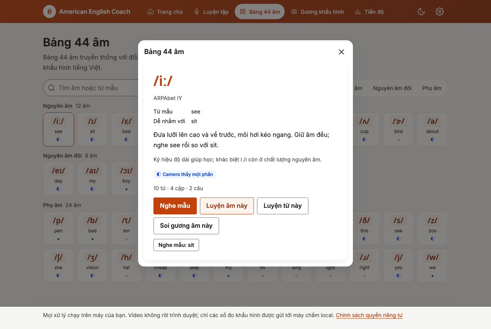
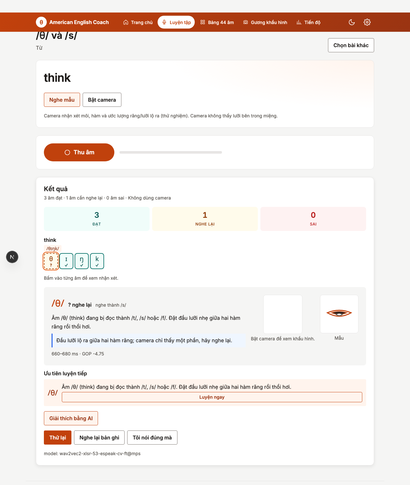
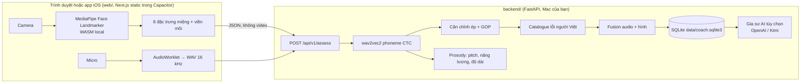

# American English Coach

Huấn luyện viên phát âm tiếng Anh Mỹ cho người Việt, chạy hoàn toàn trên máy của bạn: **gương khẩu hình** (camera + MediaPipe trong trình duyệt), **chấm âm vị** (wav2vec2 local, điểm GOP), **trọng âm và ngữ điệu** (gợi ý), **luyện trọn 44 âm**, gia sư AI tùy chọn, giao diện tiếng Việt, web và app iOS. Không tài khoản, video không rời thiết bị.

_An offline-first American English pronunciation coach for Vietnamese learners: mouth-shape mirror, phoneme scoring, prosody hints and drills for all 44 sounds, on your own machine, with an optional AI tutor and an iOS app._

| Bảng 44 âm                                             | Luyện với camera và kết quả theo từng âm                                   |
| ------------------------------------------------------ | -------------------------------------------------------------------------- |
|  |  |

## Bắt đầu nhanh (macOS Apple Silicon)

Yêu cầu: Python 3.12 + [uv](https://docs.astral.sh/uv/), Node ≥ 24, giọng tiếng Anh Mỹ của macOS (`Samantha`), khoảng 2 GB trống cho model và thư viện.

```sh
make install     # tooling repo, backend (uv sync), web (npm install), MediaPipe vào web/public
make models      # tải model âm vị (~1,2 GB) vào data/models và ghi checksum vào docs/DATA-MANIFEST.json
make doctor      # kiểm tra Python, nội dung, CMUdict, model, `say`, cổng
make serve       # build web tĩnh rồi chạy API + web trên http://127.0.0.1:8765
```

Khi phát triển: `make api` (FastAPI :8765, reload) và `make web` (Next.js dev :3200, proxy `/api/v1` sang API). `make help` liệt kê mọi lệnh.

## Tính năng

- **Luyện trọn 44 âm**: mỗi âm có bộ bài riêng (6–10 từ ở vị trí đầu/giữa/cuối, cặp tối thiểu, 2 câu), tất cả kiểm tra tự động bằng CMUdict (`content/sound_drills.json`, 440 từ). Mọi âm đều được camera theo dõi: 12 nhóm khẩu hình phủ đủ 39 âm vị Mỹ, mỗi nhóm ghi mức tin cậy ("camera thấy rõ / thấy một phần / chỉ thấy môi-hàm, chấm bằng tai").
- **Luyện phát âm AI**: cặp tối thiểu theo lỗi phổ biến của người Việt (think/sink, she/see, vest/west, bad/bed, âm cuối -p/-t/-s…), câu kể và câu hỏi. Ghi âm trong trình duyệt (WAV 16 kHz), nhận thẻ kết quả theo từng âm với ba mức `ok / check / error`, âm máy nghe được, gợi ý tiếng Việt và khẩu hình lúc phát âm.
- **Gương khẩu hình**: hiệu chỉnh cá nhân 6 bước (20 giây); thanh đo độ tròn môi, độ mở hàm, môi khép, môi dưới chạm răng, thấy răng, thấy lưỡi (ước lượng bằng màu vùng trong miệng, thử nghiệm); gợi ý khi lệch quá 0,5 s; viền xanh khi giữ đúng. Hình được ghép với âm theo mốc thời gian để nâng/giảm mức kết luận (bảng luật fusion).
- **Trọng âm, ngữ điệu, nhịp**: so độ nổi bật âm tiết với trọng âm từ điển (REcord/reCORD), hướng giọng cuối câu hỏi/câu kể, tỷ lệ dài âm nhấn/không nhấn. Chỉ ở mức gợi ý.
- **Bảng 44 âm IPA** với hướng dẫn khẩu hình tiếng Việt, từ mẫu, giọng mẫu local.
- **Gia sư AI (tùy chọn; mặc định OpenAI GPT‑6 Luna, hoặc Kimi / API tương thích OpenAI)**: giải thích kết quả đã chấm bằng tiếng Việt (model không chấm lại, không được thêm lỗi) và nhận xét **một ảnh chụp miệng** khi người học bấm "Hỏi AI về khẩu hình" (gửi một ảnh JPEG, không gửi video). Tắt mặc định; bật bằng `.env` theo `.env.example`.
- **Tiến độ do máy đo** theo từng âm, lịch sử lượt luyện, nút "Tôi nói đúng mà" (ghi nhận để hiệu chỉnh).

## Kiến trúc



Chi tiết: [docs/architecture/README.md](docs/architecture/README.md), quyết định: [docs/adr](docs/adr), quy ước code: [docs/conventions.md](docs/conventions.md), kiểm thử: [docs/testing.md](docs/testing.md), số đo: [docs/BENCHMARK-REALTIME.md](docs/BENCHMARK-REALTIME.md), iOS: [docs/ios.md](docs/ios.md).

## Ứng dụng iOS

`web/ios/` là app iOS (Capacitor + Swift host) bọc đúng bản web: camera, thu âm và giao diện chạy trong app; máy chấm chạy trên Mac cùng mạng Wi‑Fi. `make ios-run` build và mở trên simulator; `make api-lan` + `make ios-open` để chạy trên iPhone thật (nhập địa chỉ máy chấm trong Tiến độ → Cài đặt). Chi tiết: [docs/ios.md](docs/ios.md); dùng từ xa qua HTTPS: [docs/remote-access.md](docs/remote-access.md).

## Riêng tư

API bind `127.0.0.1` (hoặc `0.0.0.0` khi bạn chạy `make api-lan` cho điện thoại). Trình duyệt chỉ gửi tám đặc trưng miệng (số đo, không ảnh) và chuỗi điểm viền môi, không gửi video. Bản ghi âm chỉ dùng để chấm rồi bỏ; kết quả nằm ở `data/coach.sqlite3`. Gia sư AI chỉ gọi ra ngoài khi được bật trong `.env` và khi người học bấm nút; mỗi lần gửi JSON kết quả hoặc một ảnh miệng. Không telemetry.

## Giới hạn cần biết

- Camera **không thấy lưỡi bên trong miệng**; app ước lượng răng/lưỡi lộ ra bằng màu vùng trong môi (thử nghiệm). /θ ð/ và phần lớn khác biệt nguyên âm vẫn dựa vào audio.
- Mức `error` chỉ bật cho lỗi đã đo precision ≥ 0,85 trên tập đánh giá (`content/enabled_errors.json`). Hiện danh sách này **rỗng** vì tập đánh giá sẵn có (speechocean762, người nói Mandarin) chưa cho precision đủ cao; mọi lỗi hiển thị ở mức `check` ("nghe lại") cho đến khi có dữ liệu người Việt.
- Giọng mẫu là TTS của macOS (`say`), không phải người thật; gợi ý ngữ điệu so với giọng này.
- iOS: chưa ký phát hành TestFlight; kết nối máy chấm qua HTTP trong mạng nội bộ.

## Chất lượng

`make ci` = lint + typecheck + test cho backend (ruff, mypy strict, pytest với coverage ≥ 90%) và web (ESLint 0 cảnh báo, Stylelint BEM + token, tsc, Vitest), cộng Prettier và commitlint (Conventional Commits, scope trong `commitlint.config.mjs`). CI trên GitHub Actions chạy cùng bộ lệnh. `make e2e` chạy Playwright với camera/micro giả.

## Cấu trúc

```
backend/   FastAPI + domain + adapter ML (uv, ruff, mypy, pytest)
web/       Next.js static export (TS strict, ESLint, Stylelint, Vitest, Playwright) + web/ios (Capacitor)
content/   nội dung tiếng Việt: 44 âm, bộ bài 44 âm, catalogue lỗi, viseme, cặp tối thiểu, câu, enabled_errors
vendor/    CMUdict, ipa-dict, thichhoc (giấy phép trong legacy/static/licenses)
legacy/    app stdlib phiên bản đầu (vẫn chạy: cd legacy && python3 app.py)
docs/      kế hoạch, ADR, kiến trúc, quy ước, kiểm thử, benchmark, manifest dữ liệu, iOS, ảnh chụp
data/      (không commit) model, dataset đánh giá, SQLite, audio cache
```

## Giấy phép dữ liệu và model

Xem [docs/DATA-MANIFEST.json](docs/DATA-MANIFEST.json): wav2vec2-xlsr-53-espeak-cv-ft (Apache-2.0), MediaPipe Face Landmarker và `@mediapipe/tasks-vision` (Apache-2.0), CMUdict (BSD), ipa-dict (MIT), thichhoc (dịch máy, ghi nhãn), speechocean762 (CC BY 4.0, chỉ dùng đánh giá), Noto Sans và Inter (OFL).
