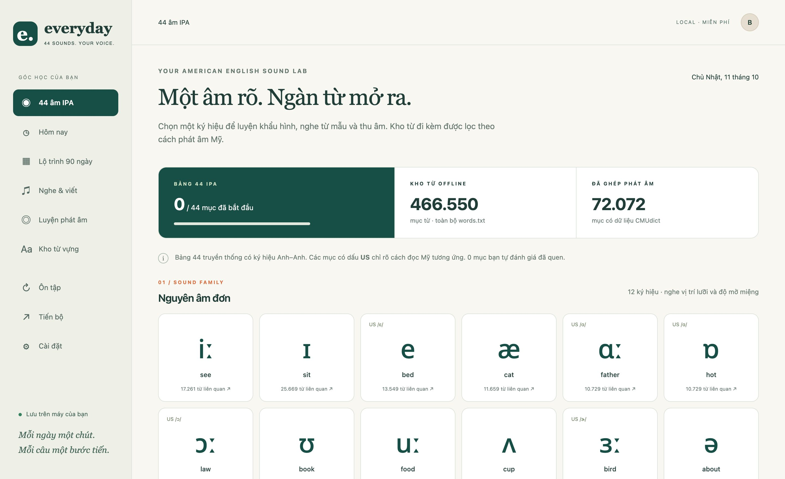
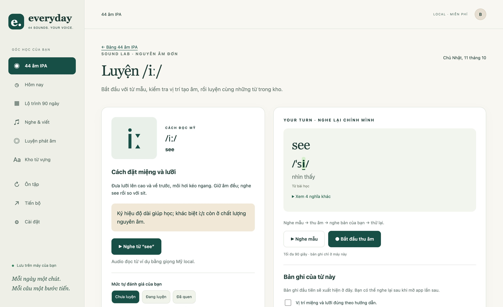
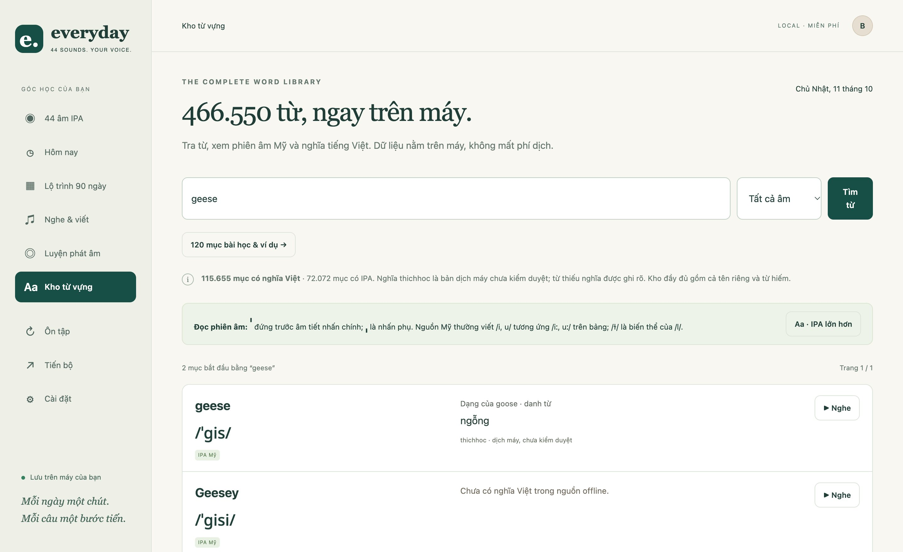
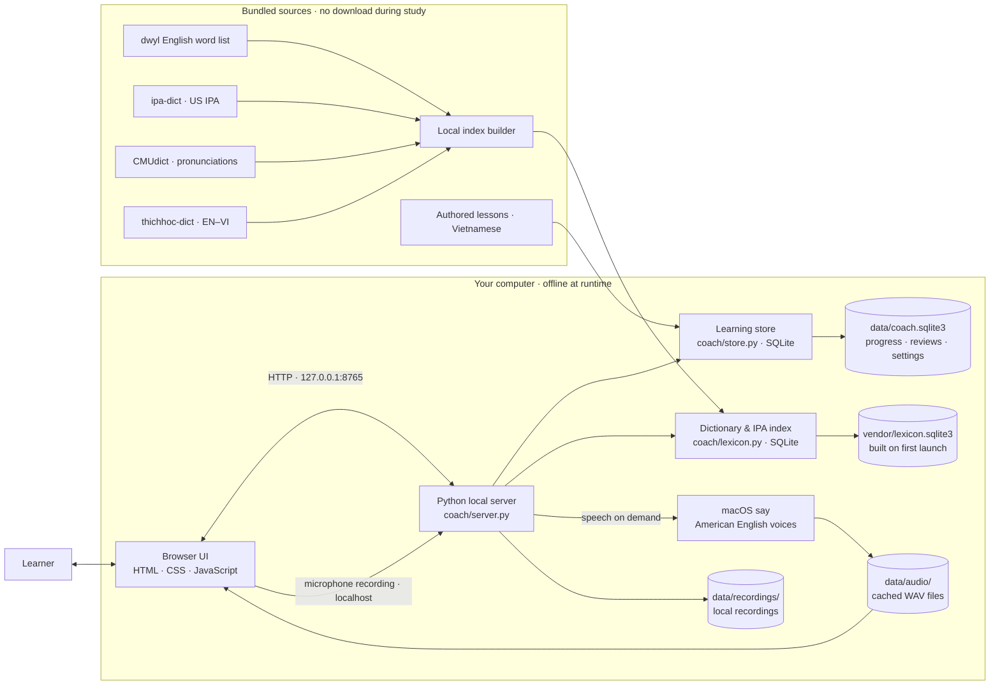

# American English Coach

An offline-first pronunciation and vocabulary trainer for Vietnamese learners of American English. Study the traditional 44-sound IPA chart, listen to example words, record your voice, and explore a local dictionary of 466,550 entries.

The app runs on your computer. It requires no account, API key, paid service, or runtime internet connection. Its interface and pronunciation guidance are in Vietnamese.

## Screenshots

| 44-sound IPA chart                                                                              | Guided sound practice                                                                                            |
| ----------------------------------------------------------------------------------------------- | ---------------------------------------------------------------------------------------------------------------- |
|  |  |



## Architecture

Everything used while studying runs on the same computer. The browser talks only to the loopback Python server. The pronunciation index is built locally from the bundled data; speech uses macOS `say`; learning state, recordings, and generated audio stay in local files.



The project does not send audio, search queries, or learning progress to a cloud service.

## Features

- **44 IPA sounds:** Vietnamese articulation tips, American English mappings, example words, and related vocabulary.
- **Readable American IPA:** source pronunciations from `ipa-dict`, syllable stress, visible sound highlighting, and a larger-type option.
- **Word practice:** play a local voice example, record yourself in the browser, and play back recordings saved on your computer.
- **Offline dictionary:** search the 466,550-word `dwyl/english-words` list by prefix and browse pronunciations and Vietnamese meanings when available.
- **Listening and review:** short listening-and-dictation exercises, vocabulary review, a 12-week/90-day practice schedule, and local progress tracking.
- **Privacy by default:** the server listens on `127.0.0.1`; recordings, cached audio, and learning progress stay in the local `data/` directory.

## Quick start

### macOS

Requirements: Python 3.9 or newer and a built-in macOS English voice. No Python packages need to be installed.

```sh
git clone https://github.com/deputychinh/American-English-Coach.git
cd American-English-Coach
./start.command
```

The launcher starts the local server and opens the app at <http://127.0.0.1:8765>. You can also start it from Terminal:

```sh
python3 app.py
```

Keep the Terminal window open while you study; press `Ctrl+C` to stop the server. If port `8765` is in use, choose another port with `python3 app.py --port 8767`.

On first launch, the app builds a local SQLite search index from the included word, pronunciation, and translation data. It rebuilds the index if it is missing or out of date. The macOS `say` voices used for audio are `Samantha` and `Eddy (English (US))`; select a voice in Settings. Generate-audio-on-demand keeps the repository smaller than bundling audio for every word.

The web interface can open on other platforms, but local text-to-speech is currently implemented with macOS `say` and is not supported on Windows or Linux.

## Start learning

1. Open **44 IPA Sounds** and choose a sound.
2. Read the Vietnamese mouth and tongue guidance, then listen to the example word.
3. Record yourself and play the recording back. The app does not grade your accent automatically.
4. Browse words that use the sound. Select a word to see its American IPA and Vietnamese meaning when available.
5. Use **Aa · Larger IPA** if you want a bigger transcription. The choice is remembered in your browser.
6. Mark sounds as new, practicing, or comfortable to keep track of your own progress.

## Data coverage and limitations

| Dataset                                 |                                         Current coverage |
| --------------------------------------- | -------------------------------------------------------: |
| Traditional IPA chart entries           | 44, with notes for corresponding American pronunciations |
| `dwyl/english-words` entries            |                                                  466,550 |
| Entries matched to an IPA pronunciation |                                                   72,072 |
| Entries with a Vietnamese meaning       |                                                  115,655 |
| Authored starter lessons                |          120 word cards and 60 sentences across 12 weeks |

Coverage is source-based. The vocabulary list includes rare words, proper names, and entries with numbers or symbols. Many entries do not yet have an IPA transcription or Vietnamese meaning; the app labels missing data rather than inventing it.

Vietnamese meanings are from **thichhoc-dict**. The source project says its Vietnamese translations are machine-generated and have not been human-reviewed. The app labels these meanings accordingly. Inflected forms such as `geese` link to their headword (`goose`).

IPA is taken from **ipa-dict** when available. If only CMUdict data is available, the app converts its pronunciation symbols and omits stress rather than guessing syllable boundaries. A word can have several pronunciations; the TTS voice may use a different variant from the displayed transcription.

The 44-symbol chart follows a traditional teaching convention that includes some British notation. It shows American correspondences and explains notation differences; it does not claim that American English has exactly 44 distinct phonemes.

The 90-day schedule reuses the starter material; it does not contain 90 independent lesson packs. There is no speech recognition, automatic pronunciation assessment, or CEFR certification. Three months of practice is a study goal, not a guaranteed proficiency outcome.

## Local data and backups

- Progress, preferences, and review schedule: `data/coach.sqlite3`.
- Voice recordings: `data/recordings/`.
- Generated speech cache: `data/audio/`.
- JSON export includes progress, not recordings. To back up everything, stop the app and copy the entire `data/` directory.
- Restoring a JSON export replaces existing learning progress after you confirm in the app.
- Use `python3 app.py --data-dir /path/to/profile` to run a separate profile. Do not run two app processes against the same data directory at once.

The generated search index at `vendor/lexicon.sqlite3` is intentionally excluded from Git. The app rebuilds it from the included data files when needed. Keep your `data/` directory when updating the project.

## Development and checks

The app backend uses Python's standard library, SQLite, and the system `say` command. The UI uses plain HTML, CSS, and JavaScript. Node.js is only needed to run the UI helper tests.

```sh
python3 -m unittest discover -s tests -q
node --test tests/lexicon-view.test.mjs
node --check static/app.js
```

See [verification notes](docs/VERIFICATION.md), the [product brief](PRODUCT-BRIEF.md), the [repository research](docs/REPOSITORY-RESEARCH.md), and the [data manifest](docs/DATA-MANIFEST.json).

## Data sources and attribution

- [dwyl/english-words](https://github.com/dwyl/english-words): word list. See `vendor/ENGLISH-WORDS-LICENSE.md`.
- [CMUdict](https://github.com/cmusphinx/cmudict): ARPAbet pronunciations. BSD license; see `vendor/CMUDICT-LICENSE`.
- [ipa-dict](https://github.com/open-dict-data/ipa-dict): American English IPA. MIT license; see `vendor/IPA-DICT-LICENSE`.
- [thichhoc-dict](https://github.com/thichhoc-org/thichhoc-dict): Vietnamese meanings and inflections. Dictionary data is CC BY-SA 4.0. The app links forms and indexes fields without rewriting the meanings; this derived dictionary data remains CC BY-SA 4.0. Full terms and required attribution are in `vendor/thichhoc/LICENSE-DATA` and in the app's **Data sources and licenses** section.
- [Noto Sans](https://github.com/google/fonts/tree/main/ofl/notosans): bundled font under the SIL Open Font License; see `vendor/NOTO-SANS-OFL.txt`.

Source file sizes and SHA-256 checksums are listed in [docs/DATA-MANIFEST.json](docs/DATA-MANIFEST.json).
