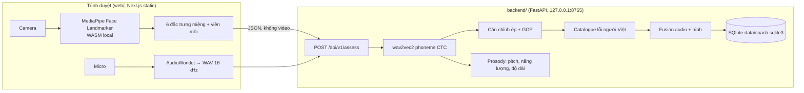

# American English Coach

Huấn luyện viên phát âm tiếng Anh Mỹ cho người Việt, chạy hoàn toàn trên máy của bạn: **gương khẩu hình** (camera + MediaPipe trong trình duyệt), **chấm âm vị** (wav2vec2 local, điểm GOP), **trọng âm và ngữ điệu** (gợi ý), giao diện tiếng Việt. Không tài khoản, không API key, video không rời trình duyệt.

_An offline-first American English pronunciation coach for Vietnamese learners: mouth-shape mirror, phoneme scoring and prosody hints, all on your own machine._

| Bảng 44 âm | Luyện với camera và kết quả theo từng âm |
| --- | --- |
|  |  |

## Bắt đầu nhanh (macOS Apple Silicon)

Yêu cầu: Python 3.12 + [uv](https://docs.astral.sh/uv/), Node ≥ 24, giọng tiếng Anh Mỹ của macOS (`Samantha`), khoảng 2 GB trống cho model và thư viện.

```sh
make install     # tooling repo, backend (uv sync), web (npm install), MediaPipe vào web/public
make models      # tải model âm vị (~1,2 GB) vào data/models và ghi checksum vào docs/DATA-MANIFEST.json
make doctor      # kiểm tra Python, nội dung, CMUdict, model, `say`, cổng
make serve       # build web tĩnh rồi chạy API + web trên http://127.0.0.1:8765
```

Khi phát triển: `make api` (FastAPI :8765, reload) và `make web` (Next.js dev :3200, proxy `/api/v1` sang API). `make help` liệt kê mọi lệnh.

## Tính năng

- **Luyện phát âm AI**: cặp tối thiểu theo lỗi phổ biến của người Việt (think/sink, she/see, vest/west, bad/bed, âm cuối -p/-t/-s…), câu kể và câu hỏi. Ghi âm trong trình duyệt (WAV 16 kHz), nhận thẻ kết quả theo từng âm với ba mức `ok / check / error`, âm máy nghe được, gợi ý tiếng Việt và khẩu hình lúc phát âm.
- **Gương khẩu hình**: hiệu chỉnh cá nhân 20 giây; thanh đo độ tròn môi, độ mở hàm, môi khép, môi dưới chạm răng; gợi ý khi lệch quá 0,5 s; viền xanh khi giữ đúng. Hình được ghép với âm theo mốc thời gian để nâng/giảm mức kết luận (bảng luật fusion).
- **Trọng âm, ngữ điệu, nhịp**: so độ nổi bật âm tiết với trọng âm từ điển (REcord/reCORD), hướng giọng cuối câu hỏi/câu kể, tỷ lệ dài âm nhấn/không nhấn. Chỉ ở mức gợi ý.
- **Bảng 44 âm IPA** với hướng dẫn khẩu hình tiếng Việt, từ mẫu, giọng mẫu local.
- **Tiến độ do máy đo** theo từng âm, lịch sử lượt luyện, nút "Tôi nói đúng mà" (ghi nhận để hiệu chỉnh).

## Kiến trúc



Chi tiết: [docs/architecture/README.md](docs/architecture/README.md), quyết định: [docs/adr](docs/adr), quy ước code: [docs/conventions.md](docs/conventions.md), kiểm thử: [docs/testing.md](docs/testing.md), số đo: [docs/BENCHMARK-REALTIME.md](docs/BENCHMARK-REALTIME.md).

## Riêng tư

API bind `127.0.0.1`. Trình duyệt chỉ gửi sáu đặc trưng miệng mỗi khung hình và chuỗi điểm viền môi, không gửi video. Bản ghi âm chỉ dùng để chấm rồi bỏ; kết quả nằm ở `data/coach.sqlite3`. Không telemetry, không gọi dịch vụ ngoài khi học.

## Giới hạn cần biết

- Camera **không thấy lưỡi**: /θ ð/ và phần lớn khác biệt nguyên âm dựa vào audio.
- Mức `error` chỉ bật cho lỗi đã đo precision ≥ 0,85 trên tập đánh giá (`content/enabled_errors.json`). Hiện danh sách này **rỗng** vì tập đánh giá sẵn có (speechocean762, người nói Mandarin) chưa cho precision đủ cao; mọi lỗi hiển thị ở mức `check` ("nghe lại") cho đến khi có dữ liệu người Việt.
- Giọng mẫu là TTS của macOS (`say`), không phải người thật; gợi ý ngữ điệu so với giọng này.
- Điện thoại: giao diện responsive và PWA, nhưng mở từ điện thoại qua mạng LAN cần HTTPS (chưa thiết lập).

## Chất lượng

`make ci` = lint + typecheck + test cho backend (ruff, mypy strict, pytest với coverage ≥ 90%) và web (ESLint 0 cảnh báo, Stylelint BEM + token, tsc, Vitest), cộng Prettier và commitlint (Conventional Commits, scope trong `commitlint.config.mjs`). CI trên GitHub Actions chạy cùng bộ lệnh. `make e2e` chạy Playwright với camera/micro giả.

## Cấu trúc

```
backend/   FastAPI + domain + adapter ML (uv, ruff, mypy, pytest)
web/       Next.js static export (TS strict, ESLint, Stylelint, Vitest, Playwright)
content/   nội dung tiếng Việt: 44 âm, catalogue lỗi, viseme, cặp tối thiểu, câu, enabled_errors
vendor/    CMUdict, ipa-dict, thichhoc (giấy phép trong legacy/static/licenses)
legacy/    app stdlib phiên bản đầu (vẫn chạy: cd legacy && python3 app.py)
docs/      kế hoạch, ADR, kiến trúc, quy ước, kiểm thử, benchmark, manifest dữ liệu, ảnh chụp
data/      (không commit) model, dataset đánh giá, SQLite, audio cache
```

## Giấy phép dữ liệu và model

Xem [docs/DATA-MANIFEST.json](docs/DATA-MANIFEST.json): wav2vec2-xlsr-53-espeak-cv-ft (Apache-2.0), MediaPipe Face Landmarker và `@mediapipe/tasks-vision` (Apache-2.0), CMUdict (BSD), ipa-dict (MIT), thichhoc (dịch máy, ghi nhãn), speechocean762 (CC BY 4.0, chỉ dùng đánh giá), Noto Sans và Inter (OFL).
