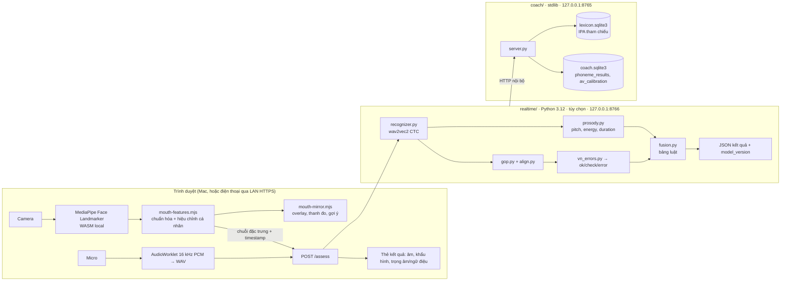

# Kế hoạch 24 giờ: Huấn luyện viên phát âm AI (khẩu hình + âm vị + ngữ điệu) cho người Việt

Phiên bản 1 · 2026-10-16 · Trạng thái: **chờ duyệt**. Sau khi duyệt, thực hiện liên tục trong 24 giờ máy.

Tài liệu nền: [PRODUCT-BRIEF.md](../PRODUCT-BRIEF.md) (ràng buộc local, 0 chi phí), [REALTIME-AV-COACH-PLAN.md](REALTIME-AV-COACH-PLAN.md) (lộ trình đầy đủ P0–P6, 4–6 tháng), [REPOSITORY-RESEARCH.md](REPOSITORY-RESEARCH.md) (so sánh công nghệ).

---

## 0. Kết luận một trang

**Mục tiêu người dùng:** học sinh Việt Nam tự tin phát âm tiếng Anh Mỹ nhờ phản hồi về **khẩu hình**, **âm vị**, **trọng âm/ngữ điệu**, dùng được trên web và điện thoại.

**Thực tế phải nói thẳng:** tầm nhìn đầy đủ (gia sư hội thoại AI, phát hiện lưỡi, kiểm chứng với người học) đã được ước lượng 4–6 tháng trong `REALTIME-AV-COACH-PLAN.md`. **24 giờ không hoàn thành tầm nhìn đó.** 24 giờ đủ để giao một **MVP chạy được, có đo đạc, có test**, gồm 4 khả năng cốt lõi dưới đây, xây trên app `american-english-coach` đang chạy (không làm lại từ đầu).

| # | Khả năng giao trong 24h | Cách làm | Mức tin cậy công bố với người học |
|---|---|---|---|
| 1 | **Gương khẩu hình realtime** (30 fps, trong trình duyệt) | MediaPipe Face Landmarker (478 landmark + 52 blendshape) chạy local, so hình miệng với mẫu từng âm, thanh đo + gợi ý tiếng Việt | Nhóm môi/hàm (V1, V2, V4–V7). Camera **không thấy lưỡi**; nói rõ với người học |
| 2 | **Chấm âm vị từ audio** (từ, cặp tối thiểu, câu) | wav2vec2 phoneme CTC local → căn chỉnh với IPA tham chiếu CMUdict → `ok / check / error`, ưu tiên danh sách lỗi người Việt | Chỉ hiện `error` cho âm có precision đo được ≥ 0,85; còn lại hiện `check` |
| 3 | **Trọng âm + ngữ điệu cơ bản** | Cao độ (pyin), năng lượng, độ dài âm tiết từ mốc thời gian CTC; so với giọng mẫu | Chỉ ở mức gợi ý `check` (chưa có dữ liệu người Việt để hiệu chỉnh ngưỡng) |
| 4 | **Web + điện thoại (PWA)** | Màn hình "Luyện phát âm AI" trong app hiện có, responsive, manifest + service worker; chạy từ máy Mac, mở bằng điện thoại cùng mạng nếu bật HTTPS | Mobile native **không** làm trong 24h |

**Không làm trong 24h** (giữ nguyên trong lộ trình dài): gia sư hội thoại LLM, phát hiện lưỡi /θ ð/ bằng ảnh, model fusion học máy, pilot người học thật, app iOS/Android native, Kokoro TTS, FSRS.

**Ràng buộc kế thừa:** chạy local trên Apple Silicon, không API trả phí, video không rời trình duyệt, lõi stdlib hiện tại vẫn chạy khi tắt tính năng mới (33 test hiện có phải pass).

---

## 1. Nghiên cứu đã thực hiện (ngày 2026-10-16)

### 1.1 Khẩu hình (vision)

- **MediaPipe Face Landmarker** là lựa chọn duy nhất khả thi trong 24h: chạy trong trình duyệt bằng WASM/GPU, gói `@mediapipe/tasks-vision`, model `face_landmarker.task` (float16), tùy chọn `outputFaceBlendshapes` cho 52 hệ số biểu cảm ([tài liệu Web](https://developers.google.com/edge/mediapipe/solutions/vision/face_landmarker/web_js), [tổng quan](https://developers.google.com/edge/mediapipe/solutions/vision/face_landmarker/index)). Lưu ý tài liệu: blendshape `*Left/*Right` theo mặt người, ảnh soi gương làm đảo chiều.
- Blendshape là hệ số biểu cảm, **không phải viseme**; phải tự dựng ánh xạ âm → mẫu miệng từ `jawOpen`, `mouthPucker`, `mouthFunnel`, `mouthClose`, `mouthRollLower`, `mouthStretch*`, `mouthSmile*`. Bộ tên theo ARKit ([Apple](https://developer.apple.com/documentation/arkit/arfaceanchor/blendshapelocation)).
- Lipreading cả câu (AV-HuBERT, Auto-AVSR, PyTorch real-time AV-ASR) là stack Python nặng, chưa có bản trình duyệt, Auto-AVSR chỉ cho phép benchmark ([AV-HuBERT](https://www.arxiv.org/pdf/2201.02184), [Auto-AVSR repo](https://github.com/AV-LLM/AVSR), [PyTorch blog](https://pytorch.org/blog/real-time-speech-rec/)). **Loại khỏi MVP.**

### 1.2 Chấm âm vị (audio)

- Chuẩn thực hành cộng đồng: checkpoint `facebook/wav2vec2-xlsr-53-espeak-cv-ft` (hoặc `wav2vec2-lv-60-espeak-cv-ft`) xuất IPA kiểu espeak, căn chỉnh với chuỗi tham chiếu bằng edit distance → nhãn đúng/thay/bỏ/thêm ([OpenPronounce](https://github.com/Halleck45/OpenPronounce), [pronounce-assess](https://pypi.org/project/pronounce-assess/), [Wav2Vec2Phoneme docs](https://huggingface.co/docs/transformers/v4.57.1/model_doc/wav2vec2_phoneme), [ví dụ wav2vec2 + LLM](https://github.com/crazycloud/mispronunciation-detection-diagnosis-wav2vec2-and-llm)).
- OpenPronounce tự công bố false alarm đáng kể; vì vậy MVP dùng **ba mức kết luận** và chỉ bật `error` theo precision đo được (nguyên tắc đã chốt ở plan dài).
- Nghiên cứu MDD cho tiếng Việt (LingWav2Vec2, Interspeech 2024, F1 59,68% trên VLSP 2023) là bài toán **phát âm tiếng Việt**, không phải người Việt nói tiếng Anh; chỉ tham khảo kiến trúc ([A*STAR](https://oar.a-star.edu.sg/communities-collections/articles/14308)). Khung MDD đa ngôn ngữ nhận biết L1 ([arXiv 2309.07719](https://arxiv.org/pdf/2309.07719)) là hướng sau MVP.
- Azure Pronunciation Assessment có đủ accuracy/fluency/prosody/phoneme, giá ngang speech-to-text (~1 USD/giờ theo Q&A tháng 11/2025, chưa xác minh 2026) ([Microsoft Q&A](https://learn.microsoft.com/en-us/answers/questions/5608069/pricing-and-usage-of-pronunciation-assessment-feat), [how-to](https://docs.azure.cn/en-us/ai-services/speech-service/how-to-pronunciation-assessment)). **Loại** theo ràng buộc 0 chi phí; giữ làm phương án so sánh nếu chủ dự án đổi ràng buộc.

### 1.3 Lỗi phát âm đặc trưng của người Việt (căn cứ cho danh sách ưu tiên)

Bằng chứng mạnh nhất là **bỏ/vô thanh hóa âm cuối** (khảo sát 56 sinh viên ĐBSCL; Ha 2005; [CTU Journal](https://ctujs.ctu.edu.vn/index.php/ctujs/article/download/448/610/3089), [VJOL](https://vjol.info.vn/index.php/tctbgd/article/download/105603/88870)); đuôi -s/-ed mất nghĩa ngữ pháp ([HPU TESOL WP](https://www.hpu.edu/research-publications/tesol-working-papers/2023/1_trang_pham.pdf)). /θ ð/ không có trong tiếng Việt; /ʃ/↔/s/; cụm phụ âm; âm tiết cân bằng làm sai trọng âm; **thanh điệu** chuyển sang ngữ điệu tiếng Anh ([BoldVoice](https://boldvoice.com/blog/english-pronunciation-vietnamese-speakers), [PronunciationPro](https://cdn.pronunciationpro.com/wp-content/uploads/2020/08/Vietnamese-NEW.pdf)). Chất lượng nguồn: nghiên cứu nhỏ + tài liệu giảng dạy; đủ để **xếp ưu tiên**, chưa đủ để làm ngưỡng.

### 1.4 Dữ liệu đánh giá

| Bộ | Dùng cho | Khả thi trong 24h |
|---|---|---|
| [speechocean762](https://www.openslr.org/101) (CC BY 4.0, 5.000 câu, nhãn chuyên gia cấp âm vị, người nói Mandarin) | Kiểm tra pipeline GOP, tỷ lệ false alarm trên âm được chấm đúng | **Có** (tải trực tiếp) |
| [L2-ARCTIC v5](https://psi.engr.tamu.edu/l2-arctic-corpus/) (CC BY-NC 4.0; 4 người Việt HQTV, PNV, THV, TLV; ~150 câu/người có nhãn thay/bỏ/thêm) | Baseline đúng nhóm người Việt | **Không chắc**: phải điền form, nhận link qua email. Gửi yêu cầu ngay giờ 1; nếu link về trước giờ 19 thì chạy, không thì ghi là việc sau |
| Tập đối chứng tổng hợp bằng macOS `say` (think / tink / sink…) | Kiểm tra sanity: pipeline không báo lỗi trên mẫu đúng, báo đúng âm trên mẫu sai | **Có**, tạo trong vài phút |
| Bản ghi chủ dự án (20 câu) | Hiệu chỉnh ngưỡng cá nhân, demo | Nếu chủ dự án thu trong ngày |

### 1.5 Môi trường thực tế (đã kiểm tra trên máy)

| Hạng mục | Kết quả |
|---|---|
| Máy | Apple M4 Pro, 48 GB RAM, 152 GB trống |
| Python | 3.9.6 hệ thống (lõi app); 3.10–3.13 có sẵn; `uv 0.12` |
| Node / Docker | Node 26.10, npm 11.19; Docker 29.8 |
| Thiếu | ffmpeg, espeak-ng, sox, mkcert, ollama, torch |
| Repo | 33 test unittest pass (12,4 s); Node test 2 pass; `docs/REALTIME-AV-COACH-PLAN.md` chưa commit, `PRODUCT-BRIEF.md` có sửa chưa commit |

Hệ quả: ghi âm **WAV PCM 16 kHz ngay trong trình duyệt** (AudioWorklet) để không cần ffmpeg; IPA tham chiếu lấy từ CMUdict/ipa-dict đã có nên không cần espeak-ng; gói AI dùng venv Python 3.12 riêng bằng `uv`.

---

## 2. Kiến trúc MVP

**Quyết định kỹ thuật (kế thừa D1–D7 của plan dài, thêm 4 quyết định mới):**

| # | Quyết định | Lý do |
|---|---|---|
| D8 | Xây **trong repo hiện có**, không tạo repo/framework mới | Đã có IPA, từ điển, nội dung Việt, test, launcher; đổi sang Next.js/React tốn ≥ 6h không tạo giá trị cho người học |
| D9 | Frontend giữ **vanilla JS modules** (`.mjs`) như hiện tại; thêm PWA manifest + service worker | Nhất quán, không build step, test bằng `node --test` |
| D10 | Ghi âm WAV trong trình duyệt, không giải mã WebM phía server | Bỏ phụ thuộc ffmpeg; mốc thời gian audio và khung hình cùng `performance.now()` |
| D11 | Model chính `facebook/wav2vec2-xlsr-53-espeak-cv-ft` (PyTorch, MPS); dự phòng `vitouphy/wav2vec2-xls-r-300m-timit-phoneme` (ARPAbet) nếu độ trễ hoặc ánh xạ ký hiệu không đạt ở cổng G1 | Có tài liệu dùng cho GOP; dự phòng nhỏ hơn, xuất ARPAbet khớp CMUdict |
| D12 | Prosody chỉ xuất **gợi ý `check`**, không điểm số | Chưa có dữ liệu người Việt để hiệu chỉnh; giọng mẫu là TTS `say`, không phải người thật |

---

## 3. Lịch 24 giờ

Giờ tính từ lúc được duyệt (H0). Mỗi khối kết thúc bằng một sản phẩm kiểm tra được. **Cổng (G)** là điểm tôi tự quyết định theo tiêu chí ghi sẵn; chỉ dừng hỏi khi vượt ngoài tiêu chí.

| Giờ | Khối | Việc cụ thể | Sản phẩm / tiêu chí |
|---|---|---|---|
| H0–H1 | **Chuẩn bị** | Commit tài liệu chưa commit; tạo nhánh `feat/av-mvp`; `realtime/pyproject.toml` + `uv venv` 3.12; tải model (ghi checksum vào `DATA-MANIFEST.json`); gửi form xin L2-ARCTIC; bắt đầu tải speechocean762 nền | Venv chạy `import torch, transformers` trên MPS |
| H1–H3 | **Spike đo đạc** | `realtime/eval/bench_phoneme.py` đo p50/p95 clip 3 s (CPU vs MPS); tải `@mediapipe/tasks-vision` + `face_landmarker.task` vào `static/vendor/mediapipe/`; trang `static/lab/face.html` đo fps và in 7 đặc trưng miệng | `docs/BENCHMARK-REALTIME.md` có số thật |
| **H3** | **Cổng G1** | Đạt nếu: phoneme p95 ≤ 1,5 s **và** MediaPipe ≥ 24 fps Chrome. Nếu không: chuyển model dự phòng (D11) / giảm 480p. Nếu cả hai dự phòng hỏng: báo chủ dự án | Quyết định ghi vào BENCHMARK |
| H3–H7 | **Audio pipeline** | `phonemes.py` ánh xạ espeak-IPA/ipa-dict/CMUdict → 39 âm nội bộ, **test phủ toàn bộ ký hiệu** trong 3 nguồn; `recognizer.py` (lazy load, posterior theo khung, mốc thời gian âm vị); `align.py` Needleman–Wunsch có trọng số theo độ gần âm vị; `gop.py` GOP theo căn chỉnh CTC; `vn_errors.py` (bảng §4); `assess.py` xuất JSON; FastAPI `POST /assess` tại 127.0.0.1:8766; tập đối chứng `say` | `curl` một WAV trả JSON có từng âm + mốc thời gian; tập `say`: 0 `error` trên mẫu đúng, ≥ 80% bắt được thay thế cố ý |
| H7–H10 | **Gương khẩu hình** | `static/mouth-features.mjs` (aperture, width, roundness, jaw, lipClosed, lowerLipTuck, quality; chuẩn hóa theo khoảng cách mắt; EMA); luồng hiệu chỉnh 20 s (nghỉ, "ee", "oo", "ah", "mmm"); `content/visemes.json` cho V1, V2, V4, V5, V6, V7 (~16 âm) + SVG mẫu; `static/mouth-mirror.mjs` overlay viền môi, thanh đo, gợi ý Việt sau ≥ 500 ms lệch, viền xanh khi giữ đúng `hold_ms` | `tests/mouth-features.test.mjs` với landmark giả pass; thử tay 6 nhóm trên Chrome |
| H10–H13 | **Trọng âm + ngữ điệu v1** | `prosody.py`: pitch (librosa pyin), năng lượng RMS, độ dài âm tiết từ mốc CTC + số âm tiết CMUdict; trọng âm: so độ nổi bật (độ dài × năng lượng × cao độ) của âm tiết nhấn so với âm tiết khác và so với mẫu `say`; ngữ điệu: hướng cuối câu (lên/xuống) + khoảng cách DTW chuẩn hóa với mẫu | Test với WAV `say` của `record` (danh/động), câu hỏi/câu kể; đầu ra chỉ `ok/check` |
| H13–H15 | **Fusion + lưu trữ** | `fusion.py` bảng luật (§5) + test bảng chân trị; `/assess` nhận thêm chuỗi đặc trưng miệng, cắt theo mốc âm vị (±60 ms); mở rộng `coach/store.py`: bảng `phoneme_results`, `av_calibration` (migration an toàn, không đụng dữ liệu cũ); API nội bộ ghi kết quả + nút "Tôi nói đúng mà" (`disputed=1`) | Test store mới + 33 test cũ pass |
| H15–H19 | **Giao diện + PWA** | Màn hình "Luyện phát âm AI": chọn bài (cặp tối thiểu theo lỗi người Việt: *think/sink, she/see, bad/bed, vest/west, cap/cat, live/life*, 12 cặp của `units.json`, 10 câu); panel camera (tắt được), nút ghi, thẻ kết quả: dòng thời gian từ, âm tô theo mức, bấm âm → viền môi lúc đó cạnh mẫu, gợi ý trọng âm/ngữ điệu; tiến độ máy đo hiển thị **tách** với tự đánh giá; `manifest.webmanifest` + service worker (shell offline); responsive 390 px; cờ `realtime.enabled`, UI ẩn khi tiến trình 8766 không chạy | Không lỗi console; không request mạng ngoài 127.0.0.1 (test) |
| H19–H21 | **Đánh giá + ngưỡng** | speechocean762 (200 câu, split theo người nói): tương quan GOP với điểm chuyên gia; **false alarm theo từng âm** trên âm chuyên gia chấm đúng; L2-ARCTIC người Việt nếu đã có link; chốt danh sách âm được bật `error` (precision ≥ 0,85), còn lại `check` | Bảng số trong `BENCHMARK-REALTIME.md`; file `realtime/enabled_errors.json` |
| H21–H23 | **Kiểm chứng + đóng gói** | Toàn bộ test Python + Node; e2e smoke Chromium với `--use-fake-device-for-media-stream` (camera/mic giả) qua Playwright: mở bài → ghi → thẻ kết quả; launcher `setup-realtime` (tải model, checksum) và `doctor` (camera, mic, model, cổng); cập nhật README, VERIFICATION, DATA-MANIFEST, giấy phép (Apache-2.0 MediaPipe, model card, CC BY speechocean762) | Lệnh chạy một dòng cho người mới; VERIFICATION ghi số thật |
| H23–H24 | **Dự phòng + bàn giao** | Bù trễ; commit theo từng khối; báo cáo bàn giao: đã làm, số đo, chưa làm, việc tiếp theo | Báo cáo cuối trong `docs/HANDOFF-24H.md` |

**Ưu tiên khi thiếu giờ (cắt từ dưới lên):** (1) L2-ARCTIC, (2) e2e Playwright thay bằng kiểm tra tay có ảnh chụp, (3) ngữ điệu DTW (giữ trọng âm), (4) PWA service worker (giữ responsive). **Không cắt:** test ánh xạ âm vị, ba mức kết luận, cổng precision, test cũ pass.

---

## 4. Danh sách lỗi người Việt dùng trong `vn_errors.py` (v1)

| Ưu tiên | Lỗi | Audio | Camera hỗ trợ | Bài luyện trong MVP |
|---|---|---|---|---|
| 1 | Bỏ âm cuối /p b m f v/ | deletion | **Có** (V1/V2 ở cuối từ) | stop, live, five, come |
| 2 | /θ/→/t s f/, /ð/→/d z/ | substitution | Không (lưỡi) → audio + hình tĩnh | think/sink, this/dis |
| 3 | /ʃ/→/s/, /tʃ/→/s/ | substitution | **Có** (V5 môi chu) | she/see, chip/sip |
| 4 | /v/↔/w/, /w/ yếu | substitution | **Có** (V2 so V4) | vest/west, very/wary |
| 5 | /æ/→/ɛ/ | substitution | Một phần (jawOpen) | bad/bed, cap/cat |
| 6 | /iː/↔/ɪ/, /uː/↔/ʊ/ | substitution + độ dài | Yếu | seat/sit, pool/pull |
| 7 | Bỏ âm cuối /t d k g s z/, -s/-ed, cụm phụ âm | deletion | Không | worked, cats, street |
| 8 | Trọng âm sai, nhịp đều, ngữ điệu phẳng/thanh điệu | prosody | Không | REcord/reCORD, câu hỏi yes/no |

Mỗi dòng kèm `hint_vi` và `mouth_tip_vi` lấy/viết thêm từ `content/phonemes.tsv` (đã có 44 mục hướng dẫn tiếng Việt).

---

## 5. Bảng luật fusion v1 (cài đúng như plan dài, có test)

| Audio | Hình (âm V1–V7, chất lượng khung đủ) | Kết luận hiển thị |
|---|---|---|
| ok | ok | `ok` |
| ok | sai | `ok` + gợi ý khẩu hình nhẹ |
| check | sai | nâng thành `error` kèm gợi ý khẩu hình |
| error | sai | `error` tin cậy cao, ưu tiên hiện |
| error | ok | `error` theo audio, không gợi ý khẩu hình |
| bất kỳ | chất lượng kém / camera tắt | chỉ audio |

---

## 6. Tiêu chí nghiệm thu cuối 24h (Definition of Done)

1. `python3 app.py` chạy như cũ; tắt `realtime` thì toàn bộ 33 test cũ + test mới của store pass.
2. `realtime` bật: `POST /assess` trả JSON gồm từng âm (nhãn, GOP, mốc thời gian, mức), trọng âm/ngữ điệu (`ok/check`), `model_version`; p95 ≤ 1,5 s cho câu 3 s trên máy này.
3. Gương khẩu hình ≥ 24 fps Chrome; hiệu chỉnh cá nhân lưu/nạp lại; 6 nhóm V có mẫu + gợi ý Việt; camera bị từ chối vẫn học được bằng audio.
4. Tập đối chứng `say`: 0 `error` trên mẫu đúng; ≥ 80% thay thế cố ý được bắt ở mức `check` trở lên.
5. speechocean762 (200 câu): báo cáo false alarm theo âm; chỉ âm đạt precision ≥ 0,85 được bật `error`.
6. Không request ra ngoài `127.0.0.1` khi học (test tự động); video không rời trình duyệt; đặc trưng miệng chỉ lưu khi người học bật.
7. Tài liệu: BENCHMARK-REALTIME, VERIFICATION, DATA-MANIFEST, giấy phép, HANDOFF-24H đều có số thật, ghi rõ phần chưa làm.

---

## 7. Rủi ro riêng của 24h và cách xử lý

| Rủi ro | Xác suất | Xử lý |
|---|---|---|
| Ánh xạ ký hiệu espeak-IPA → nội bộ thiếu/sai (âm đôi, /ɹ/, schwa có r) | Cao | Test phủ toàn bộ vocab model; ký hiệu lạ → `check`, không `error`; dự phòng model ARPAbet (D11) |
| Model lớn (~1,2 GB) tải chậm hoặc Hub lỗi | Trung bình | Tải ngay H0 ở nền; cache tại `~/.cache/huggingface` |
| Prosody trên TTS mẫu không phản ánh người thật | Cao | Chỉ `check`; ghi nhãn "mẫu TTS" trong UI và tài liệu |
| L2-ARCTIC không về kịp | Cao | Không chặn; speechocean762 + tập `say`; ghi việc sau |
| Điện thoại cần HTTPS cho camera/mic | Chắc chắn | MVP chạy trên Mac; hướng dẫn `mkcert` + bind LAN là tùy chọn ở H21 nếu còn giờ |
| MediaPipe trên Safari chậm hơn Chrome | Trung bình | Chrome là mục tiêu chính; Safari chỉ smoke test, ghi số |
| Phạm vi phình (LLM, lưỡi, avatar) | Cao | Danh sách "không làm" ở §0; mọi thêm mới phải qua chủ dự án |

---

## 8. Việc tôi tự quyết và việc cần chủ dự án quyết

**Tự quyết (theo tiêu chí ghi sẵn):** chọn model theo cổng G1; thứ tự cắt khi thiếu giờ (§3); ngưỡng `error` theo precision đo được; chi tiết UI trong khuôn khổ giao diện hiện có; commit nhỏ theo khối trên nhánh `feat/av-mvp`, **không push, không merge** nếu chưa được yêu cầu.

**Cần duyệt trước H0 (nếu không trả lời, tôi dùng mặc định in đậm):**

1. Xây trên repo `american-english-coach` hay tạo dự án mới? → **Mặc định: repo hiện có** (D8).
2. Giữ ràng buộc local / 0 chi phí / không API key? → **Mặc định: giữ.** Nếu cho phép Azure, thêm 2 giờ làm adapter tùy chọn, đổi lại có điểm prosody đã hiệu chỉnh.
3. Điện thoại: chỉ cần responsive trên Mac trong 24h, hay bắt buộc mở từ điện thoại qua LAN (HTTPS)? → **Mặc định: responsive + PWA, LAN là tùy chọn cuối.**
4. Dự án cá nhân/nghiên cứu hay sẽ thương mại? Quyết định có dùng L2-ARCTIC (CC BY-NC). → **Mặc định: cá nhân/nghiên cứu, được dùng.**
5. Trình duyệt chính? → **Mặc định: Chrome; Safari smoke test.**
6. Chủ dự án có thể thu 20 câu giọng mình trong ngày để hiệu chỉnh/demo không? Không bắt buộc.

---

## 9. Sau 24h (nối vào lộ trình P3–P6 của plan dài)

Pilot 5–10 học sinh có đồng ý; hiệu chỉnh ngưỡng khẩu hình trên dữ liệu người Việt; gia sư hội thoại local (VAD → Whisper → LLM → TTS); phát hiện lưỡi; fusion học máy; app native (có thể bọc PWA bằng Capacitor); Kokoro TTS thay `say`; FSRS.
