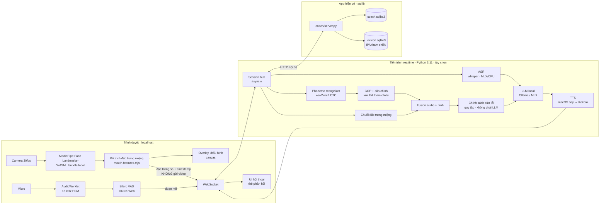

# Kế hoạch: AI hội thoại + theo dõi khẩu hình realtime

Phiên bản 1 · 2026-10-16 · Trạng thái: **đề xuất, chưa triển khai, chưa benchmark**.

Tài liệu liên quan: [product brief](../PRODUCT-BRIEF.md), [nghiên cứu repo và công nghệ giọng nói](REPOSITORY-RESEARCH.md).

Mọi con số độ trễ, độ chính xác và thời gian dưới đây là **mục tiêu cần đo**, không phải kết quả đã đạt.

---

## 0. Tóm tắt một trang

**Ý tưởng:** một gia sư AI nói chuyện với người học bằng tiếng Anh Mỹ. Gia sư nghe giọng và nhìn miệng người học qua webcam để phát hiện âm phát chưa chuẩn, rồi hướng dẫn chỉnh khẩu hình ngay trên màn hình.

**Kết luận khả thi:**

| Phần                                                    | Khả thi?                         | Ghi chú quan trọng                                                                                     |
| ------------------------------------------------------- | -------------------------------- | ------------------------------------------------------------------------------------------------------ |
| Nhìn môi/hàm realtime trong trình duyệt (30 fps)        | **Có**, chạy local               | MediaPipe Face Landmarker trả 478 điểm mốc và 52 blendshape (`jawOpen`, `mouthPucker`, `mouthFunnel`…) |
| Chỉnh khẩu hình **trực tiếp từng khung hình**           | **Có, ở chế độ luyện âm**        | Ứng dụng biết trước âm đích (ví dụ /uː/), nên so được hình miệng hiện tại với hình mẫu                 |
| Chỉnh khẩu hình realtime **trong lúc nói chuyện tự do** | **Hạn chế**                      | Lời nói tự do quá nhanh; chỉ hiện gợi ý nhẹ khi đang nói, phản hồi chi tiết sau mỗi lượt nói (≈1–2 s)  |
| Phát hiện sai âm từ **audio**                           | **Có, mức thử nghiệm**           | wav2vec2 nhận dạng âm vị + điểm GOP; phải đo false alarm trên giọng Việt trước khi “kết luận sai”      |
| Phát hiện sai âm chỉ từ **hình ảnh**                    | **Chỉ một phần**                 | Camera không thấy lưỡi trong miệng, vòm, thanh quản. Chỉ thấy môi, hàm, răng và đôi khi đầu lưỡi       |
| Hội thoại AI chạy hoàn toàn offline                     | **Có**, chất lượng phụ thuộc RAM | VAD → Whisper → LLM local (Ollama/MLX) → TTS local                                                     |

**Nguyên tắc thiết kế quan trọng nhất:** audio là bằng chứng chính, hình ảnh là bằng chứng phụ. LLM **không** tự chấm phát âm. LLM chỉ nhận kết quả có cấu trúc từ bộ chấm, rồi chọn cách nói với người học. Sửa sai nhầm (false alarm) gây hại hơn bỏ sót, nên mọi ngưỡng ưu tiên độ chính xác.

**Lộ trình 7 giai đoạn (P0–P6)**, mỗi giai đoạn tự dùng được:

1. **P0** Spike và benchmark phần cứng (1–2 tuần)
2. **P1** “Gương khẩu hình”: luyện âm với camera, chưa cần AI (2–3 tuần)
3. **P2** Chấm âm vị từ audio, chưa realtime (3–4 tuần)
4. **P3** Kết hợp audio + hình trong chế độ luyện âm (2–3 tuần)
5. **P4** Gia sư hội thoại bằng giọng nói (3–4 tuần)
6. **P5** Phản hồi khẩu hình trong hội thoại (2–3 tuần)
7. **P6** Kiểm chứng với người học và hoàn thiện (2–4 tuần)

Tổng ước lượng cho một lập trình viên: **khoảng 4–6 tháng**. Ước lượng này thô và cần chỉnh lại sau P0.

---

## 1. Ràng buộc kế thừa từ dự án

Ràng buộc từ `PRODUCT-BRIEF.md` vẫn giữ nguyên:

- Không API trả phí, API key hay cloud inference. Video, audio và tiến độ không rời máy.
- Mạng chỉ dùng để cài đặt và tải model. Học offline.
- Bind `127.0.0.1`. Không telemetry.
- Không bắt buộc GPU, Docker hoặc Redis. Máy mục tiêu là Apple Silicon (arm64).
- Lõi app hiện tại dùng Python 3.9 standard library, không phụ thuộc gói ngoài. **Lõi này phải tiếp tục chạy được khi tắt tính năng mới.**

Hệ quả kiến trúc: tính năng mới là một **gói tùy chọn** (`realtime` extra) có virtualenv riêng (Python 3.11+, PyTorch/ONNX). App cũ vẫn chạy như trước nếu người dùng không cài gói này.

---

## 2. Giới hạn vật lý: camera thấy được gì?

Đây là phần quyết định phạm vi. Webcam chỉ thấy các bộ phận phát âm **nhìn thấy được**. Bảng dưới phân nhóm âm Mỹ theo mức quan sát được.

### 2.1 Nhóm âm theo dấu hiệu hình ảnh (viseme)

| Nhóm                  | Âm                                                | Dấu hiệu nhìn thấy                                          | Độ tin cậy dự kiến                                                                   |
| --------------------- | ------------------------------------------------- | ----------------------------------------------------------- | ------------------------------------------------------------------------------------ |
| V1 Hai môi khép       | /p b m/                                           | Hai môi chạm nhau hoàn toàn ≥ 1–2 khung hình                | **Cao**                                                                              |
| V2 Môi dưới–răng trên | /f v/                                             | Môi dưới nâng lên chạm mép răng trên, `mouthRollLower` tăng | **Cao–trung bình**                                                                   |
| V3 Lưỡi giữa răng     | /θ ð/                                             | Đầu lưỡi lộ ra giữa hai hàm răng                            | **Trung bình**; cần phân tích điểm ảnh vùng trong miệng, không có sẵn trong landmark |
| V4 Môi tròn, chu ra   | /w uː ʊ oʊ/                                       | `mouthPucker`/`mouthFunnel` cao, độ rộng miệng giảm         | **Cao**                                                                              |
| V5 Môi chu, răng gần  | /ʃ ʒ tʃ dʒ/                                       | Môi hơi chu ra và loe, răng gần nhau                        | **Trung bình**; phân biệt với /s/ (môi dẹt)                                          |
| V6 Môi dẹt, cười      | /iː/, /s z/                                       | Độ rộng miệng tăng, hàm gần khép                            | **Trung bình**                                                                       |
| V7 Hàm mở to          | /æ ɑ aɪ aʊ/                                       | `jawOpen` cao; /æ/ thêm môi kéo ngang                       | **Trung bình**; /æ/ so với /ɛ/ là khác biệt về mức độ                                |
| V8 /r/ Mỹ             | /r ɝ ɚ/                                           | Môi hơi tròn                                                | **Thấp**; dấu hiệu chính nằm trong miệng                                             |
| Không thấy            | /t d n l k g ŋ h j/, phần lớn khác biệt nguyên âm | Lưỡi và vòm nằm trong miệng                                 | **Chỉ dùng audio**                                                                   |

**Hệ quả:** sửa khẩu hình bằng camera chỉ áp dụng cho nhóm V1–V7. Với các âm còn lại, ứng dụng chỉ dùng audio và hình minh họa tĩnh. Ứng dụng cũng phải nói rõ với người học rằng camera “không thấy được lưỡi”.

### 2.2 Lỗi phổ biến của người Việt, đối chiếu với camera

Các lỗi thường gặp (theo các nghiên cứu nhỏ trong tài liệu tham khảo ở §13): bỏ âm cuối, vô thanh hóa âm cuối, thay /θ ð/ bằng /t d/ hoặc /z/, nhầm /ʃ/ với /s/, bỏ âm trong cụm phụ âm. Bảng ưu tiên được suy ra như sau:

| Ưu tiên | Lỗi                                     | Audio phát hiện                 | Camera hỗ trợ                                        |
| ------- | --------------------------------------- | ------------------------------- | ---------------------------------------------------- |
| 1       | Bỏ âm cuối /p b m f v/ (“stop”, “live”) | GOP / deletion                  | **Có**: không thấy môi khép hoặc chạm răng ở cuối từ |
| 2       | /θ ð/ → /t d s z/ (“think”, “this”)     | Substitution                    | **Có**: không thấy đầu lưỡi                          |
| 3       | /ʃ/ → /s/ (“she”, “fish”)               | Substitution                    | **Có**: môi không chu                                |
| 4       | /w/ yếu hoặc thành /u/; /v/ ↔ /w/       | Substitution                    | **Có**: V2 so với V4                                 |
| 5       | /æ/ → /ɛ/ (“bad” → “bed”)               | Substitution                    | **Một phần**: độ mở hàm                              |
| 6       | /iː/ ↔ /ɪ/, /uː/ ↔ /ʊ/                  | Khó, cần độ dài                 | **Yếu**                                              |
| 7       | Bỏ âm cuối /t d k g s z/, cụm phụ âm    | Deletion                        | **Không**                                            |
| 8       | Trọng âm, nối âm, ngữ điệu              | Prosody, dời sang giai đoạn sau | **Không**                                            |

**Lưu ý:** Âm /p/ cuối không bật hơi kiểu tiếng Việt vẫn khép môi. Camera thấy môi khép nhưng không phân biệt được bật hơi hay không, nên phần đó dựa vào audio.

---

## 3. Kiến trúc tổng thể



### 3.1 Quyết định chính

| #   | Quyết định                                                                                          | Lý do                                                                                              |
| --- | --------------------------------------------------------------------------------------------------- | -------------------------------------------------------------------------------------------------- |
| D1  | Xử lý video **hoàn toàn trong trình duyệt**; chỉ gửi đặc trưng số                                   | Độ trễ thấp nhất, riêng tư (không có video rời trang), giảm tải backend                            |
| D2  | Tiến trình realtime **riêng**, dùng asyncio + WebSocket (đề xuất FastAPI/uvicorn hoặc `websockets`) | `http.server` hiện tại không có WebSocket; giữ lõi stdlib nguyên vẹn                               |
| D3  | Lấy IPA tham chiếu từ **CMUdict/ipa-dict đã có**, không bắt buộc espeak-ng                          | Đã có dữ liệu; tránh phụ thuộc GPL khi đóng gói; vẫn có thể dùng espeak cho từ ngoài từ điển       |
| D4  | Quy mọi ký hiệu về **bộ âm vị nội bộ ~39 âm kiểu ARPAbet**                                          | Đầu ra model (espeak IPA), ipa-dict và CMUdict dùng ký hiệu khác nhau; cần một bảng ánh xạ có test |
| D5  | **LLM không chấm điểm**; bộ chấm xuất JSON, chính sách sửa lỗi dựa trên quy tắc                     | Tránh LLM bịa lỗi; kiểm thử được; giải thích được                                                  |
| D6  | Tải model khi cần, tối đa một inference nặng cùng lúc                                               | Theo nguyên tắc của brief; tiết kiệm RAM                                                           |
| D7  | Feature flag `realtime.enabled`; UI ẩn khi tiến trình không chạy                                    | Lõi app không bị hỏng khi thiếu model                                                              |

### 3.2 Hai vòng lặp “realtime”

| Vòng              | Tần suất | Đường đi                                              | Ngân sách độ trễ (mục tiêu)                                         |
| ----------------- | -------- | ----------------------------------------------------- | ------------------------------------------------------------------- |
| **Vòng hình**     | 30 fps   | camera → MediaPipe → đặc trưng → so mẫu → overlay     | < 50 ms mỗi khung, hoàn toàn trong trình duyệt                      |
| **Vòng lượt nói** | mỗi câu  | VAD báo kết thúc → ASR + phoneme → fusion → LLM → TTS | Kết thúc nói → thẻ phản hồi ≤ 1,0 s; → tiếng gia sư bắt đầu ≤ 2,0 s |

Phân bổ cho vòng lượt nói (mục tiêu, cần đo ở P0):

| Bước                                                 |  Ngân sách |
| ---------------------------------------------------- | ---------: |
| VAD xác nhận im lặng                                 | 300–500 ms |
| ASR + phoneme recognizer (chạy song song)            | 300–500 ms |
| GOP + fusion + chính sách                            |    < 50 ms |
| LLM token đầu tiên                                   | 300–700 ms |
| TTS câu đầu tiên (chạy theo từng mệnh đề, streaming) | 200–400 ms |

---

## 4. Thành phần chi tiết

### 4.1 Vision: trích đặc trưng miệng (trình duyệt)

- **Thư viện:** `@mediapipe/tasks-vision`, chế độ `runningMode: "VIDEO"`, `outputFaceBlendshapes: true`, `outputFacialTransformationMatrixes: true`, `numFaces: 1`, gọi `detectForVideo()` mỗi khung hình.
- **Offline:** đóng gói file `.wasm` và `face_landmarker.task` vào `static/vendor/mediapipe/`. Không tải từ CDN lúc chạy. Ghi checksum vào `docs/DATA-MANIFEST.json` và giấy phép Apache-2.0 vào `static/licenses/`.
- **Đặc trưng mỗi khung** (chuẩn hóa theo khoảng cách hai khóe mắt để không phụ thuộc khoảng cách tới camera):

| Đặc trưng       | Cách tính                                                                                                                                     |
| --------------- | --------------------------------------------------------------------------------------------------------------------------------------------- |
| `aperture`      | Khoảng cách môi trong trên–dưới / khoảng cách hai mắt                                                                                         |
| `width`         | Khoảng cách hai khóe miệng / khoảng cách hai mắt                                                                                              |
| `roundness`     | `aperture / width`, kết hợp `mouthPucker` và `mouthFunnel`                                                                                    |
| `jaw`           | Blendshape `jawOpen`                                                                                                                          |
| `lipClosed`     | `aperture` < ngưỡng hiệu chỉnh và `mouthClose` cao                                                                                            |
| `lowerLipTuck`  | `mouthRollLower`, vị trí môi dưới so với mép răng trên                                                                                        |
| `protrusion`    | Độ nhô môi theo trục z sau khi bù tư thế đầu                                                                                                  |
| `tongueVisible` | **Thử nghiệm:** tỷ lệ điểm ảnh màu lưỡi trong vùng miệng trong (giai đoạn đầu dùng heuristic HSV; sau thay bằng CNN nhỏ ~50k tham số nếu cần) |
| `quality`       | Góc yaw/pitch, độ sáng, có mặt hay không, mặt bị che                                                                                          |

- **Hiệu chỉnh cá nhân (bắt buộc, khoảng 20 giây):** khuôn miệng nghỉ, nói “ee”, “oo”, “ah”, khép môi “mmm”. Lưu min/max mỗi đặc trưng để chuẩn hóa về 0–1 cho từng người. Môi mỗi người khác nhau nên không thể dùng ngưỡng tuyệt đối.
- **Lọc nhiễu:** One-Euro filter hoặc EMA. Bỏ khung khi |yaw| > 20°, |pitch| > 15° hoặc thiếu sáng, và hiện thông báo “quay mặt thẳng camera”.
- **Hiệu năng:** chạy trên Web Worker hoặc OffscreenCanvas nếu được. Nếu thấp hơn 24 fps thì giảm độ phân giải đầu vào xuống 480p.

### 4.2 Mẫu khẩu hình (“target”) cho từng âm

Mỗi âm thuộc V1–V7 có một **mẫu** trong `content/visemes.json`:

```json
{
  "id": "uw",
  "ipa": "uː",
  "group": "V4",
  "targets": {
    "roundness": { "min": 0.6 },
    "width": { "max": 0.4 },
    "jaw": { "max": 0.35 }
  },
  "hold_ms": 300,
  "hint_vi": "Chu môi tròn về phía trước như huýt sáo, hàm gần khép.",
  "common_error_vi": "Môi dẹt như chữ 'u' tiếng Việt nói nhanh.",
  "image": "static/visemes/uw.svg"
}
```

- **Nguồn mẫu:** (a) bản ghi người bản xứ, nếu có quyền dùng và có video; (b) bản ghi chính người dùng/giáo viên nói đúng, có xác nhận bằng tai; (c) giá trị khởi điểm do tay chỉnh. Đánh dấu rõ nguồn và trạng thái duyệt, như với IPA hiện có.
- **Ngưỡng tương đối** so với hiệu chỉnh cá nhân, không dùng giá trị tuyệt đối.

### 4.3 Overlay chỉnh khẩu hình

- Canvas vẽ đường viền môi người học (landmark môi trong và ngoài) chồng lên video soi gương.
- Cạnh đó là **khung mẫu** (SVG) của âm đích.
- **Thước đo trực quan:** thanh “độ tròn môi”, “độ mở hàm”. Vùng xanh là vùng mục tiêu. Mũi tên chỉ hướng cần chỉnh (“chu môi thêm ↑”).
- **Gợi ý chữ tiếng Việt** tối đa một câu, chỉ hiện sau khi lệch liên tục ≥ 500 ms. Không nhấp nháy theo từng khung.
- **Phản hồi đúng:** viền xanh + âm báo nhẹ khi giữ đúng `hold_ms`.
- **Accessibility:** không chỉ dùng màu; có chữ và biểu tượng; tôn trọng `prefers-reduced-motion`.

### 4.4 Audio: nhận dạng âm vị và chấm điểm

**Pipeline cho một lượt nói có văn bản tham chiếu (chế độ luyện):**

1. Văn bản → IPA tham chiếu qua `coach/lexicon.py`. Từ có nhiều cách đọc thì giữ **tất cả biến thể** làm đáp án chấp nhận.
2. Audio 16 kHz → **wav2vec2 phoneme CTC** (ứng viên: `facebook/wav2vec2-xlsr-53-espeak-cv-ft`, xuất IPA kiểu espeak) → log-posterior mỗi khung.
3. Ánh xạ ký hiệu model → bộ âm vị nội bộ (D4).
4. **GOP:** bắt đầu với GOP dựa trên forced alignment CTC (dễ cài). Thử thêm **GOP alignment-free / substitution-aware** (Parikh et al. 2025; Cao et al. 2025), giới hạn thay thế theo danh sách lỗi người Việt ở §2.2. Cách này vừa tăng độ chính xác vừa giảm chi phí tính toán.
5. Căn chỉnh chuỗi nhận dạng với chuỗi tham chiếu (Needleman–Wunsch có trọng số theo độ gần âm vị) để có nhãn đúng / thay thế / bỏ sót / thêm.
6. Xuất JSON có **thời điểm bắt đầu/kết thúc** từng âm. Fusion (§4.5) cần thông tin này để ghép với chuỗi hình.

**Ba mức kết luận, không dùng nhị phân đúng/sai:**

| Mức     | Điều kiện                                                | Cách hiển thị                            |
| ------- | -------------------------------------------------------- | ---------------------------------------- |
| `ok`    | GOP ≥ ngưỡng chấp nhận                                   | Không nói gì, hoặc khen ngắn             |
| `check` | Vùng xám                                                 | “Âm /θ/ nghe chưa rõ, thử lại nhé”       |
| `error` | GOP thấp **và** thay thế khớp một lỗi đã biết trong §2.2 | “Bạn đang đọc /θ/ thành /t/” + hướng dẫn |

Ngưỡng được chọn trên tập kiểm tra sao cho **precision của `error` ≥ 0,85** (mục tiêu). Nếu không đạt, lỗi đó chỉ được hiện ở mức `check`.

**Hội thoại tự do (không có văn bản tham chiếu):** dùng transcript ASR làm tham chiếu giả. Rủi ro: Whisper có xu hướng “sửa hộ” người học (nghe “tink” vẫn ra “think”), nên chỉ đánh giá những từ ASR tin cậy cao. Hạ một mức kết luận: `error` trở thành `check`, trừ khi hình ảnh cũng xác nhận.

### 4.5 Fusion audio + hình

- **Đồng bộ thời gian:** trình duyệt gắn `performance.now()` cho cả khung hình và mẫu audio. Server dùng timestamp phoneme từ CTC để cắt đoạn đặc trưng hình tương ứng (mở rộng ±60 ms vì môi thường chuyển động trước âm).
- **Luật fusion v1 (quy tắc, giải thích được):**

| Audio  | Hình (âm thuộc V1–V7) | Kết luận                                                                         |
| ------ | --------------------- | -------------------------------------------------------------------------------- |
| ok     | ok                    | `ok`                                                                             |
| ok     | sai                   | `ok` + gợi ý nhẹ về khẩu hình (không gọi là lỗi)                                 |
| check  | sai                   | Nâng thành `error`, kèm gợi ý khẩu hình                                          |
| error  | sai                   | `error`, độ tin cậy cao, ưu tiên hiện                                            |
| error  | ok                    | `error` theo audio; không đưa gợi ý khẩu hình (khẩu hình không phải nguyên nhân) |
| bất kỳ | chất lượng hình kém   | Chỉ dùng audio                                                                   |

- **v2 (sau P6, nếu có dữ liệu):** mô hình nhỏ (logistic regression hoặc GBDT) học trên đặc trưng GOP và đặc trưng hình đã gán nhãn. Tham khảo hướng audio-visual sync trong arXiv 2609.06788.

### 4.6 Gia sư hội thoại

| Thành phần | Ứng viên (chọn sau benchmark P0)                                                                               | Ghi chú                                                                                                        |
| ---------- | -------------------------------------------------------------------------------------------------------------- | -------------------------------------------------------------------------------------------------------------- |
| VAD        | Silero VAD (ONNX Web trong trình duyệt hoặc Python)                                                            | Khung ~30 ms, < 1 ms/khung trên CPU theo README. **Kiểm tra giấy phép**: README và file đóng gói ghi khác nhau |
| ASR        | `mlx-whisper` hoặc whisper.cpp (Metal); `faster-whisper` cho CPU                                               | Bắt đầu với model small.en hoặc distil; đo WER trên giọng Việt                                                 |
| LLM        | Ollama (backend MLX trên Apple Silicon) chạy model instruct 7–8B (Qwen/Gemma) cho máy 16 GB; 3–4B cho máy 8 GB | Dùng structured output (JSON); không có model nào được kiểm chứng riêng cho vai gia sư, cần tự đánh giá        |
| TTS        | Giai đoạn đầu dùng macOS `say` (đã có); sau đó Kokoro (local, nhiều giọng Mỹ)                                  | Phát theo từng mệnh đề để giảm độ trễ                                                                          |
| Barge-in   | Người học nói chen thì dừng TTS                                                                                | VAD phía trình duyệt; cần khử vọng (`echoCancellation: true`) hoặc dùng tai nghe                               |

**Hợp đồng LLM (D5):**

Đầu vào cho mỗi lượt:

```json
{
  "scenario": "ordering_coffee",
  "learner_level": "beginner",
  "transcript": "I want a tink coffee",
  "asr_confidence": 0.71,
  "assessment": [
    {
      "word": "think",
      "phoneme": "θ",
      "verdict": "error",
      "heard": "t",
      "visual": "tongue_not_visible",
      "confidence": 0.82
    }
  ],
  "correction_budget": 1,
  "history_summary": "..."
}
```

Đầu ra:

```json
{
  "reply_en": "A thick coffee? Sure! Hot or iced?",
  "correction": { "target": "θ", "word": "thick", "style": "recast" },
  "note_vi": "Đặt đầu lưỡi giữa hai hàm răng khi nói 'th'."
}
```

**Chính sách sửa lỗi** (quy tắc, nằm ngoài LLM):

- Tối đa **một** lỗi phát âm được nhắc trong mỗi lượt, và chỉ lỗi có `verdict = error`.
- Ưu tiên theo bảng §2.2 và theo trọng tâm tuần của người học.
- Không sửa cùng một âm quá hai lượt liên tiếp. Nếu lỗi lặp lại, đề nghị “luyện riêng âm này 1 phút”, chuyển sang chế độ gương (P1), rồi quay lại hội thoại.
- Kiểu sửa mặc định là **recast** (gia sư lặp lại từ đúng trong câu trả lời), sau đó mới giải thích trực tiếp.
- Có nút “Tôi nói đúng mà” để người học phản bác. Ghi lại như dữ liệu false alarm.

**Kịch bản hội thoại:** khoảng 20 tình huống (gọi cà phê, giới thiệu bản thân, hỏi đường, phỏng vấn…). Mỗi tình huống **gieo sẵn từ chứa âm đích** (ví dụ cà phê: _think, thanks, three, with_) để bộ chấm có nhiều cơ hội đo âm đó.

### 4.7 Lưu trữ (mở rộng `coach/store.py`)

```sql
CREATE TABLE av_calibration (id TEXT PRIMARY KEY, data TEXT NOT NULL, created TEXT NOT NULL);
CREATE TABLE conversation_sessions (id TEXT PRIMARY KEY, scenario TEXT NOT NULL,
    started TEXT NOT NULL, ended TEXT, summary TEXT);
CREATE TABLE conversation_turns (id TEXT PRIMARY KEY, session_id TEXT NOT NULL,
    role TEXT NOT NULL, text TEXT NOT NULL, created TEXT NOT NULL);
CREATE TABLE phoneme_results (id TEXT PRIMARY KEY, turn_id TEXT, item_id TEXT,
    word TEXT NOT NULL, phoneme TEXT NOT NULL, verdict TEXT NOT NULL,
    gop REAL, visual TEXT, model_version TEXT NOT NULL, disputed INTEGER DEFAULT 0,
    created TEXT NOT NULL);
```

- **Không lưu video.** Lưu chuỗi đặc trưng miệng (vài KB mỗi lượt) chỉ khi người học bật “Lưu để cải thiện mô hình”.
- Audio hội thoại đi theo chính sách bản ghi hiện có (`data/recordings/`), mặc định **không lưu**.
- `phoneme_results` cập nhật `phoneme_progress`. Tiến độ tự đánh giá và tiến độ do máy đo được hiển thị **riêng biệt**.

---

## 5. Kế hoạch theo giai đoạn

### P0 · Spike và benchmark (1–2 tuần)

**Mục tiêu:** có số đo thật trước khi cam kết kiến trúc.

| Việc                                                                                  | Đầu ra                           |
| ------------------------------------------------------------------------------------- | -------------------------------- |
| Đo RAM/CPU/GPU máy mục tiêu; định nghĩa cấu hình 8 GB / 16 GB / 32 GB+                | `docs/BENCHMARK-REALTIME.md`     |
| Chạy MediaPipe offline (wasm + task bundle local), đo fps trên Safari và Chrome       | Trang thử `static/lab/face.html` |
| Đo độ trễ wav2vec2 phoneme (PyTorch MPS, ONNX, CoreML) cho clip 3 s                   | Bảng p50/p95                     |
| Đo ASR (mlx-whisper so với whisper.cpp), LLM time-to-first-token, Kokoro so với `say` | Bảng p50/p95                     |
| Tải L2-ARCTIC (phần 4 người nói tiếng Việt) và speechocean762; kiểm tra giấy phép     | Ghi vào DATA-MANIFEST            |
| Đo phoneme error rate của model trên 4 người Việt trong L2-ARCTIC                     | Số liệu baseline                 |

**Cổng quyết định:** nếu độ trễ phoneme > 1 s hoặc model sai > 30% âm vị trên giọng Việt thì xem lại lựa chọn model trước khi làm P2.

### P1 · Gương khẩu hình (2–3 tuần)

Chưa cần AI nặng. Có giá trị ngay cả khi các giai đoạn sau thất bại.

- `static/mouth-features.mjs`: trích đặc trưng; **unit test bằng landmark giả** (`tests/mouth-features.test.mjs`).
- `static/mouth-mirror.mjs`: overlay, thanh đo, gợi ý.
- Luồng hiệu chỉnh 20 giây.
- `content/visemes.json` cho 7 nhóm V1–V7 (khoảng 20 âm), có SVG minh họa.
- Tích hợp vào trang “44 IPA Sounds”: nút “Luyện với camera”.
- Xử lý quyền camera bị từ chối, không có camera, nhiều khuôn mặt, ánh sáng yếu.

**Nghiệm thu:**

- ≥ 24 fps trên máy mục tiêu với Chrome và Safari.
- Trên tập tự quay ≥ 3 người × 7 nhóm × đúng/sai cố ý: phân loại đúng/sai khẩu hình đạt ≥ 85% cho V1, V2, V4 và ≥ 70% cho V3, V5, V7. Nhóm nào không đạt thì ẩn thước đo của nhóm đó, chỉ giữ hình mẫu.
- Không có request mạng ra ngoài (kiểm tra bằng DevTools hoặc test).

### P2 · Chấm âm vị từ audio (3–4 tuần)

- Thư mục mới `realtime/` (Python 3.11, `pyproject.toml` riêng, extra `[realtime]`).
- `realtime/phonemes.py`: bảng ánh xạ IPA/ARPAbet và test cho toàn bộ ký hiệu trong ipa-dict, CMUdict và đầu ra model.
- `realtime/recognizer.py`: tải model lười, inference, cache.
- `realtime/gop.py`: GOP alignment-based, sau đó thêm alignment-free.
- `realtime/align.py`: Needleman–Wunsch có trọng số.
- `realtime/vn_errors.py`: danh sách thay thế ưu tiên của người Việt.
- Endpoint: `POST /assess` (audio + văn bản) trả JSON. UI hiển thị kết quả trên trang luyện từ và câu hiện có.
- **Bộ đánh giá** `realtime/eval/`: precision, recall và F1 cho MDD trên L2-ARCTIC (người Việt) và speechocean762; báo cáo **false alarm theo từng âm**.

**Nghiệm thu:**

- Độ trễ p95 ≤ 800 ms cho câu 3 s trên máy 16 GB.
- Precision ≥ 0,85 cho các lỗi được bật ở mức `error`. Lỗi không đạt chỉ dùng mức `check`.
- Khi tắt `realtime`, lõi app và toàn bộ test hiện có vẫn pass.

### P3 · Kết hợp audio + hình trong chế độ luyện (2–3 tuần)

- Gửi chuỗi đặc trưng miệng qua WebSocket kèm audio.
- `realtime/fusion.py` cài bảng luật ở §4.5, có test bảng chân trị.
- UI: sau mỗi lần đọc, hiện dòng thời gian của từ, âm sai tô màu, bấm vào thì xem lại **đường viền môi lúc đó** (từ đặc trưng đã lưu, không phải video) đặt cạnh mẫu.
- Bài luyện cặp tối thiểu có camera: _sink/think, sea/she, vest/west, bad/bed, cap/cat_.

**Nghiệm thu:** trên tập tự quay, fusion giảm false alarm so với chỉ dùng audio cho nhóm V1–V5 (đo so sánh A/B). Nếu không giảm thì giữ hình ở vai trò “gợi ý”, không dùng để nâng mức kết luận.

### P4 · Gia sư hội thoại (3–4 tuần)

- `realtime/session.py`: máy trạng thái của lượt nói (listening → thinking → speaking → interrupted).
- VAD trong trình duyệt; ASR + recognizer chạy song song.
- `realtime/tutor.py`: prompt, ràng buộc JSON, retry khi JSON hỏng, tóm tắt lịch sử.
- `realtime/policy.py`: chính sách sửa lỗi ở §4.6, có unit test.
- `content/scenarios/*.json`: 20 tình huống, mỗi tình huống có danh sách từ đích.
- TTS streaming theo mệnh đề; barge-in.
- Nút “Tôi nói đúng mà”, “Nói chậm lại”, “Dịch câu này”.

**Nghiệm thu:**

- Từ lúc kết thúc nói đến tiếng gia sư: p50 ≤ 2,0 s, p95 ≤ 3,5 s trên máy 16 GB.
- 50 hội thoại thử: LLM tuân thủ schema ≥ 98%; **không có lượt nào LLM tự nêu lỗi phát âm không có trong `assessment`** (kiểm tra tự động).
- Gia sư vẫn chạy khi tắt camera (chỉ dùng audio).

### P5 · Khẩu hình trong hội thoại (2–3 tuần)

- **Khi đang nói:** chỉ hiện một chỉ báo nhỏ, không làm phân tâm (ví dụ chấm xanh/vàng theo chất lượng khung hình và âm đích của tình huống). Không chen gợi ý giữa câu.
- **Sau lượt nói:** thẻ phản hồi gồm từ sai, đường viền môi lúc đó so với mẫu, và nút “Luyện ngay” chuyển sang gương (P1) với đúng âm đó.
- Báo cáo cuối buổi: tối đa hai âm ưu tiên (theo brief), so sánh với buổi trước.

**Nghiệm thu:** người thử đánh giá “không bị phân tâm” ≥ 4/5 (thang Likert). Thẻ phản hồi xuất hiện ≤ 1,0 s sau khi kết thúc nói.

### P6 · Kiểm chứng và hoàn thiện (2–4 tuần)

- Pilot 5–10 người học Việt, 2 tuần, có đồng ý bằng văn bản (thu âm và đặc trưng miệng, không lưu video).
- So sánh bản ghi đầu và cuối, cho người nghe độc lập (giáo viên, nếu có) đánh giá mù.
- Đo tỷ lệ “Tôi nói đúng mà” theo từng âm. Âm nào > 20% thì hạ về mức `check`.
- Launcher: `setup-realtime` (tải model, kiểm tra checksum), `doctor` (camera, mic, model, RAM).
- Cập nhật README, VERIFICATION, DATA-MANIFEST và giấy phép.

---

## 6. Cấu trúc thư mục đề xuất

```
coach/                    # lõi hiện có, stdlib
realtime/                 # MỚI, tùy chọn
  pyproject.toml
  server.py               # WebSocket + HTTP /assess
  session.py  tutor.py  policy.py
  recognizer.py  gop.py  align.py  phonemes.py  vn_errors.py  fusion.py
  tts.py  asr.py
  eval/                   # script đánh giá MDD, độ trễ
content/
  visemes.json            # MỚI
  scenarios/*.json        # MỚI
static/
  mouth-features.mjs  mouth-mirror.mjs  conversation.mjs  audio-worklet.js
  vendor/mediapipe/       # wasm + .task, bundle local
  visemes/*.svg
tests/
  mouth-features.test.mjs
  realtime/test_phonemes.py  test_gop.py  test_fusion.py  test_policy.py
```

---

## 7. Dữ liệu và đánh giá

| Bộ dữ liệu       | Dùng để                                                            | Giấy phép / lưu ý                                                                              |
| ---------------- | ------------------------------------------------------------------ | ---------------------------------------------------------------------------------------------- |
| speechocean762   | Hiệu chỉnh GOP, đo MDD                                             | CC BY 4.0, cho phép thương mại; người nói là người Trung Quốc, không phải người Việt           |
| L2-ARCTIC v5     | Đo MDD trên **4 người nói tiếng Việt** (150 câu/người có gán nhãn) | Cần kiểm tra điều khoản trên trang TAMU trước khi dùng; nhiều khả năng chỉ dùng phi thương mại |
| Tập AV tự thu    | Ngưỡng khẩu hình, fusion                                           | Người tham gia đồng ý; lưu đặc trưng, video chỉ giữ tạm để gán nhãn rồi xóa                    |
| LRS3 / Auto-AVSR | **Không** dùng trong MVP                                           | Lipreading câu hoàn chỉnh không giải quyết được bài toán sửa âm; nặng; giấy phép hạn chế       |

**Chỉ số theo dõi liên tục:**

- MDD: precision, recall, F1 theo từng âm; **false alarm rate** là chỉ số chính.
- Hình: accuracy phân loại khẩu hình đúng/sai theo từng nhóm V; tỷ lệ khung bị loại vì chất lượng.
- Độ trễ: p50/p95 của từng bước và end-to-end.
- Người dùng: tỷ lệ phản bác, thời gian luyện, thay đổi GOP theo tuần (chỉ là chỉ báo, không phải chứng nhận).

---

## 8. Riêng tư và an toàn

- Video không rời trình duyệt (D1). Hiện chỉ báo rõ ràng khi camera đang bật; có nút tắt camera nhưng vẫn học được.
- Đặc trưng miệng là dữ liệu sinh trắc học mức thấp: mặc định không lưu; khi lưu thì nằm trong `data/` và xóa được.
- Model tải từ nguồn có checksum; không tải ngầm khi đang học.
- Không gửi gì ra ngoài `127.0.0.1`. Có test kiểm tra không có kết nối ra ngoài.
- Prompt LLM cố định trong mã; nội dung người học không bao giờ được thực thi như lệnh.

---

## 9. Rủi ro và cách giảm

| Rủi ro                                                    | Khả năng   | Ảnh hưởng  | Giảm thiểu                                                                                   |
| --------------------------------------------------------- | ---------- | ---------- | -------------------------------------------------------------------------------------------- |
| Phoneme model sai nhiều với giọng Việt, nhiều false alarm | Cao        | Cao        | Cổng ở P0; mức `check`; nút phản bác; giới hạn lỗi được bật theo precision đo được           |
| Whisper “sửa hộ” làm mất lỗi trong hội thoại tự do        | Cao        | Trung bình | Recognizer âm vị độc lập với ASR; gieo từ đích trong kịch bản                                |
| Ánh sáng, góc mặt, râu, khẩu trang làm hỏng tín hiệu hình | Trung bình | Trung bình | Chỉ số chất lượng; tự rơi về chỉ dùng audio                                                  |
| `tongueVisible` không ổn định                             | Cao        | Trung bình | Đánh dấu thử nghiệm; /θ ð/ vẫn dựa audio là chính                                            |
| RAM không đủ chạy đồng thời LLM + ASR + phoneme           | Trung bình | Cao        | Hồ sơ 8/16/32 GB; LLM nhỏ hơn; ASR dùng chung bộ mã hóa nếu được; tải/giải phóng theo chế độ |
| Độ trễ hội thoại > 3 s gây khó chịu                       | Trung bình | Trung bình | Streaming TTS, phản hồi ngắn, âm “mm-hm” ngay khi VAD kết thúc                               |
| Giấy phép model/dữ liệu không cho phép phân phối          | Trung bình | Cao        | Không bundle model vào repo; script tải với xác nhận giấy phép; ghi DATA-MANIFEST            |
| Phạm vi phình to                                          | Cao        | Cao        | Mỗi giai đoạn tự đứng được; P1 có giá trị ngay cả khi P4 bị hủy                              |

---

## 10. Câu hỏi cần chủ dự án quyết định

1. **Cấu hình máy tối thiểu** cần hỗ trợ: 8 GB hay 16 GB RAM? Câu trả lời quyết định có làm hội thoại LLM trên máy yếu không.
2. **Có cho phép chế độ cloud tùy chọn** (người dùng tự nhập API key) để có hội thoại tốt hơn không? Điều này **phá ràng buộc offline** hiện có, nên cần quyết định rõ ràng; nếu có thì chỉ bật thủ công và không bao giờ gửi video.
3. **Trình duyệt mục tiêu:** Chrome, Safari hay cả hai? (Ảnh hưởng tới WebGPU/WASM và AudioWorklet.)
4. Có tìm được **giáo viên hoặc người bản xứ** để duyệt mẫu khẩu hình và chấm mù ở P6 không?
5. Dự án là **cá nhân hay sẽ phát hành/thương mại**? Điều này quyết định bộ dữ liệu nào được dùng (L2-ARCTIC, Silero).

---

## 11. Việc làm ngay (tuần 1)

1. Tạo `docs/BENCHMARK-REALTIME.md` và trang `static/lab/face.html` chạy MediaPipe offline, hiển thị số đo fps và 7 đặc trưng miệng.
2. Script `realtime/eval/bench_phoneme.py`: chạy wav2vec2 phoneme trên 20 câu L2-ARCTIC của người Việt, in phoneme error rate và độ trễ.
3. Viết bảng ánh xạ ký hiệu `realtime/phonemes.py` kèm test (bước nền cho mọi phần sau).
4. Tự quay 5 phút video luyện V1, V2, V4 (đúng và sai cố ý) để có dữ liệu đầu tiên cho ngưỡng.

---

## 12. Không làm trong phạm vi này

- Lipreading toàn câu (đoán chữ từ môi).
- Chấm giọng “giống bản xứ” hoặc quy đổi CEFR.
- Avatar 3D nói chuyện (có thể làm sau, dùng chính blendshape để dựng miệng mẫu).
- Ứng dụng mobile native.
- Phân tích ngữ điệu và trọng âm tự động (giai đoạn sau, khi phần âm vị đã ổn định).

---

## 13. Tài liệu tham khảo

**Vision**

- [MediaPipe Face Landmarker cho Web](https://developers.google.com/edge/mediapipe/solutions/vision/face_landmarker/web_js): 478 landmark, 52 blendshape, `detectForVideo`, gói `@mediapipe/tasks-vision`.
- [Apple ARKit blendshape locations](https://developer.apple.com/documentation/arkit/arfaceanchor/blendshapelocation): định nghĩa `jawOpen`, `mouthFunnel`, `mouthPucker`… (MediaPipe dùng cùng bộ tên).
- [Danh sách 52 ARKit morph target (Ready Player Me)](https://docs.readyplayer.me/ready-player-me/api-reference/avatars/morph-targets/apple-arkit).

**Chấm phát âm**

- [Parikh et al., Enhancing GOP in CTC-Based MDD with Phonological Knowledge (Interspeech 2025)](https://arxiv.org/abs/2506.02080): GOP alignment-free giới hạn thay thế theo lỗi phổ biến.
- [Cao et al., Segmentation-Free Goodness of Pronunciation](https://arxiv.org/abs/2507.16838): GOP-SA / GOP-AF cho model CTC.
- [Evaluating Logit-Based GOP Scores for MDD](https://arxiv.org/abs/2506.12067): dùng `facebook/wav2vec2-xlsr-53-espeak-cv-ft`.
- [Comparison of End-to-end Speech Assessment Models (NOCASA 2025)](https://arxiv.org/html/2509.03256v1).
- [Yang et al., wav2vec2 momentum pseudo-labeling cho MDD](https://arxiv.org/abs/2203.15937).
- [Ví dụ wav2vec2 + Needleman–Wunsch + LLM feedback](https://github.com/crazycloud/mispronunciation-detection-diagnosis-wav2vec2-and-llm): bản mẫu cộng đồng, chưa được kiểm chứng.
- [OpenPronounce](https://github.com/Halleck45/OpenPronounce), [GOPT](https://github.com/YuanGongND/gopt): đã nêu trong REPOSITORY-RESEARCH.

**Audio-visual**

- [When Speech Meets Lips: Audio-Visual Synchronization for L2 Pronunciation Assessment](https://arxiv.org/abs/2609.06788).
- [Yoon, Hasegawa-Johnson & Sproat, landmark-based error detection (Interspeech 2010)](https://www.isca-archive.org/interspeech_2010/yoon10_interspeech.html).
- [Auto-AVSR](https://arxiv.org/abs/2303.14307) và [PyTorch real-time AV-ASR](https://pytorch.org/blog/real-time-speech-rec/): tham khảo, ngoài phạm vi MVP.

**Dữ liệu**

- [speechocean762 (OpenSLR 101)](https://openslr.org/101/), CC BY 4.0.
- [L2-ARCTIC](https://psi.engr.tamu.edu/l2-arctic-corpus/), có 4 người nói tiếng Việt.

**Hội thoại local**

- [Silero VAD](https://pypi.org/project/silero-vad), [VAD trong trình duyệt (micdrop)](https://micdrop.dev/blog/voice-activity-detection-browser).
- [Micdrop: Whisper + Kokoro + Ollama local](https://micdrop.dev/docs/ai-integration/local-models).
- [whisper.cpp](https://github.com/ggml-org/whisper.cpp), [faster-whisper](https://github.com/SYSTRAN/faster-whisper), [Kokoro](https://github.com/hexgrad/kokoro).
- [Ollama và MLX trên Apple Silicon (2026)](https://techsy.io/blog/best-tools-run-llms-locally): nguồn thứ cấp, số liệu chỉ để tham khảo.

**Lỗi phát âm của người Việt**

- [Nguyen, final consonant errors, IC-HUSO 2019](https://hs.kku.ac.th/ichuso/2019/034-ICHUSO-2019.pdf).
- [Can Tho University Journal 2022](https://ctujs.ctu.edu.vn/index.php/ctujs/article/download/448/610/3089).
- [ĐH Đông Nai: lỗi âm cuối và cụm phụ âm](https://www.vjol.info.vn/index.php/NNDS/article/view/20281).
- [/θ ð/ ở sinh viên năm hai (JST-UD)](https://jst-ud.vn/jst-ud/article/download/185/185).
- [ĐH Trà Vinh 2025: /s/–/ʃ/, bỏ âm cuối](https://vjol.vista.gov.vn/khxhvn/article/view/108500).
