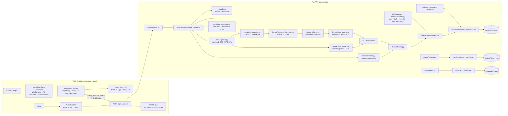

# Kiến trúc

Một máy, hai tiến trình khi phát triển (API :8765, web :3200), một tiến trình khi dùng (`make serve`: API phục vụ cả web tĩnh).

## Luồng một lượt luyện

1. Web tải `GET /content/visemes` (mục tiêu khẩu hình, bước hiệu chỉnh) và `GET /calibration`.
2. Người học bấm ghi: AudioWorklet thu PCM 16 kHz; cùng lúc MediaPipe chạy mỗi khung, `mouth-features` tính `aperture, width, roundness, jaw, lipClosed, lowerLipTuck` (chuẩn hóa 0–1 theo min/max hiệu chỉnh) và `quality` (góc mặt, có mặt).
3. Khi dừng: web gửi multipart `audio` (WAV), `text`, `item_id`, `kind`, `mouth_frames` (JSON), `audio_started_at` (cùng gốc `performance.now()` với `t` của khung).
4. API: decode → CMUdict (chọn biến thể gần nhất với chuỗi nghe được) → wav2vec2 → GOP + căn chỉnh → catalogue → verdict audio → cắt cửa sổ khung hình theo mốc thời gian âm vị (±60 ms) → viseme → fusion → prosody → lưu → trả `AssessmentResponse`.
5. Web vẽ dòng thời gian từ/âm, tô theo mức, bấm âm xem gợi ý; nút “Tôi nói đúng mà” gọi `POST /runs/{id}/dispute`.

## Mô hình dữ liệu (SQLite)

| Bảng | Trường chính |
|---|---|
| `assessment_runs` | `id` (uuid), `item_id`, `text`, `model_version`, `created_at`, `ok_count/check_count/error_count`, `result_json`, `disputed` |
| `phoneme_results` | `run_id` → runs, `word`, `phoneme` (ARPAbet), `verdict`, `gop`, `visual`, `error_id` |
| `calibrations` | `id='default'`, `data_json` (min/max mỗi đặc trưng), `created_at` |

Lược đồ được tạo bằng `metadata.create_all` khi khởi động (một người dùng, một file); đổi lược đồ phá vỡ tương thích phải kèm script di trú và ADR.

## Quy ước lớp

- `domain/`: thuần Python + numpy, không framework, không I/O ngoài đọc `content/`. Test exhaustively.
- `ml/`: adapter quanh torch/librosa/soundfile/`say`; implement port `domain/ports.py`. Test bằng `FakeRecognizer`.
- `services/`: use case; một phương thức công khai mỗi use case; nhận collaborator qua constructor.
- `routes/`: validate → gọi một service → trả model. Lỗi domain đổi sang problem+json một lần ở `main.py`.
- `container.py`: composition root (lazy singletons); test truyền `recognizer` giả.
