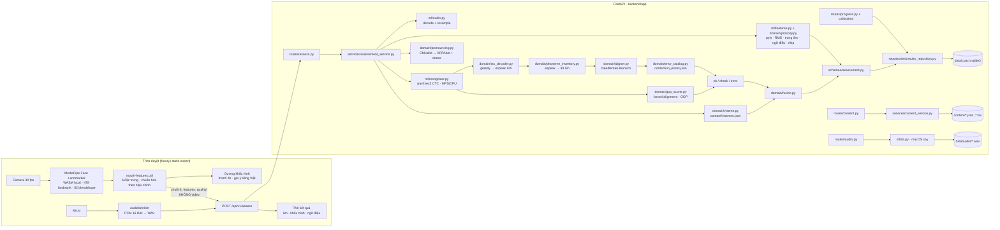

# Kiến trúc

Một máy, hai tiến trình khi phát triển (API :8765, web :3200), một tiến trình khi dùng (`make serve`: API phục vụ cả web tĩnh).

## Luồng một lượt luyện

1. Web tải `GET /content/visemes` (mục tiêu khẩu hình, bước hiệu chỉnh) và `GET /calibration`.
2. Người học bấm ghi: AudioWorklet thu PCM 16 kHz; cùng lúc MediaPipe chạy mỗi khung, `mouth-features` tính `aperture, width, roundness, jaw, lipClosed, lowerLipTuck` (chuẩn hóa 0–1 theo min/max hiệu chỉnh) và `quality` (góc mặt, có mặt).
3. Khi dừng: web gửi multipart `audio` (WAV), `text`, `item_id`, `kind`, `mouth_frames` (JSON), `audio_started_at` (cùng gốc `performance.now()` với `t` của khung).
4. API: decode → CMUdict (chọn biến thể gần nhất với chuỗi nghe được) → wav2vec2 → GOP + căn chỉnh → catalogue → verdict audio → cắt cửa sổ khung hình theo mốc thời gian âm vị (±60 ms) → viseme → fusion → prosody → lưu → trả `AssessmentResponse`.
5. Web vẽ dòng thời gian từ/âm, tô theo mức, bấm âm xem gợi ý; nút “Tôi nói đúng mà” gọi `POST /runs/{id}/dispute`.

## Mô hình dữ liệu (SQLite)

| Bảng              | Trường chính                                                                                                                                                |
| ----------------- | ----------------------------------------------------------------------------------------------------------------------------------------------------------- |
| `profiles`        | `id` (8 hex, `default` cho hồ sơ ngầm định), `name`, `created_at` — người học trên máy chấm này                                                             |
| `assessment_runs` | `id` (uuid), `profile_id` → profiles, `item_id`, `text`, `model_version`, `created_at` (UTC), `ok_count/check_count/error_count`, `result_json`, `disputed` |
| `phoneme_results` | `run_id` → runs, `word`, `phoneme` (ARPAbet), `verdict`, `gop`, `visual`, `error_id`                                                                        |
| `calibrations`    | `id` = `profile_id`, `data_json` (min/max mỗi đặc trưng), `created_at`                                                                                      |
| `devices`         | `token` (khóa), `name`, `created_at`, `last_seen_at` — điện thoại đã ghép nối                                                                               |

`GET /plan?tz_offset&goal` (app/domain/planner.py, thuần) tính chuỗi ngày liên tiếp, 7 ngày gần nhất theo múi giờ người học và 3 âm trọng tâm: yếu (≥ 3 mẫu, tỷ lệ đạt < 70 %), ôn lại (đạt nhưng ≥ 3 ngày chưa luyện), mới (chưa luyện, theo thứ tự bảng âm).

`GET /course` (content/course.json, 14 ngày × 3–7 mục) chấm tiến độ theo `item_id` đã lưu của hồ sơ: `sound:<id>:*`, `pair:<id>:*`, `sentence:<id>`; ngày xong khi mọi mục có ≥ 1 lần thu. `GET /audio` ưu tiên clip người thật có giấy phép trong `content/voice/manifest.json` (header `X-Coach-Voice: human|tts`) rồi mới tới `say`.

Hồ sơ đang dùng do thiết bị chọn và gửi trong header `X-Coach-Profile` (thiếu = `default`); `/profiles` có tạo/đổi tên/xóa, `/profiles/{id}/export` và `/profiles/import` chuyển toàn bộ lượt chấm + hiệu chỉnh giữa hai máy chấm (định dạng `aec-profile/1`).

Lược đồ do **Alembic** quản lý (`backend/alembic/versions`): API tự chạy `upgrade head` khi mở DB (`app/db/migrate.py`); DB tạo trước khi có Alembic được đóng dấu baseline `0001` rồi nâng cấp. Mọi thay đổi lược đồ đi kèm một revision mới (`make migrate` để chạy tay).

## Quy ước lớp

- `domain/`: thuần Python + numpy, không framework, không I/O ngoài đọc `content/`. Test exhaustively.
- `ml/`: adapter quanh torch/librosa/soundfile/`say`; implement port `domain/ports.py`. Test bằng `FakeRecognizer`.
- `services/`: use case; một phương thức công khai mỗi use case; nhận collaborator qua constructor.
- `routes/`: validate → gọi một service → trả model. Lỗi domain đổi sang problem+json một lần ở `main.py`.
- `container.py`: composition root (lazy singletons); test truyền `recognizer` giả.

## Ngoại tuyến có kiểm soát (web)

`web/public/sw.js` là service worker nguồn; `npm run build` chạy `scripts/build-sw.mjs` để đóng dấu build id của Next và danh sách mọi file `_next/static` vào `out/sw.js` (file API phục vụ). Ba chiến lược:

| Nhóm                                                                                                  | Chiến lược                                                                                                                                                                                                                       | Cache                            |
| ----------------------------------------------------------------------------------------------------- | -------------------------------------------------------------------------------------------------------------------------------------------------------------------------------------------------------------------------------- | -------------------------------- |
| Vỏ ứng dụng: 10 route HTML, `_next/static`, icon, manifest, worklet, runtime MediaPipe                | cache-first; precache lúc cài (bỏ qua từng file lỗi thay vì hủy cả lô); điều hướng khớp bỏ query string, route lạ khi ngoại tuyến rơi về `/`; mỗi build một cache, `activate` xóa cache build cũ                                 | `coach-shell-<build id>`         |
| API đọc-only: `content/*`, `course`, `plan`, `progress`, `profiles`, `calibration`, `runs/*`, `audio` | network-first; phản hồi 200 gần nhất được giữ, khóa theo URL + `X-Coach-Profile` + `X-Coach-Voice` nên hồ sơ nào xem lịch sử hồ sơ đó; giọng mẫu được tải trọn file và cắt `206` theo `Range` khi phát từ cache (Safari yêu cầu) | `coach-api-v1` (sống qua deploy) |
| Còn lại: `health`/`ready`, `assess`, `pair`, mọi request không phải GET, khác origin                  | không chạm — trạng thái máy chấm luôn là thật; ngoại tuyến thì banner trang chủ báo "Máy chấm chưa chạy… Bạn vẫn xem được bài học"                                                                                               | —                                |

Giới hạn: chấm điểm, gia sư AI và lưu hiệu chỉnh cần API; runtime MediaPipe (≈40 MB) chỉ vào cache sau lần mở gương đầu tiên; vỏ native iOS không đăng ký service worker (file đã đóng gói). Kiểm chứng: `web/src/components/RegisterServiceWorker/service-worker-*.test.ts` chạy `sw.js` trong `node:vm` với CacheStorage giả; `web/e2e/offline.spec.ts` làm ấm rồi `context.setOffline(true)`.

## Vận hành

- **Log**: JSON một dòng mỗi sự kiện (`app/logging_setup.py`); mỗi request có `X-Request-Id` (trả về trong header, ghi trong log truy cập và log lỗi). Không log audio, ảnh, key.
- **Probe**: `GET /api/v1/health` (liveness, cờ tính năng) và `GET /api/v1/ready` (DB trả lời, model có mặt).
- **Ghép nối điện thoại**: client không phải loopback phải gửi `X-Coach-Token`; token nhận từ `POST /api/v1/pair` với mã 6 số in trong log khi API chạy trên mạng (`make api-lan`, `COACH_PAIRING_CODE` để cố định). `/health`, `/ready`, `/pair` và file tĩnh luôn mở.
- **Giới hạn**: gia sư AI 10 yêu cầu/phút/client (429), upload audio ≤ 8 MB, ảnh ≤ 2 MB.
- **Chế độ không model**: `COACH_RECOGNIZER=fake` để chạy API trong CI/demo; kết quả gắn `model_version = fake-recognizer@ci`.
